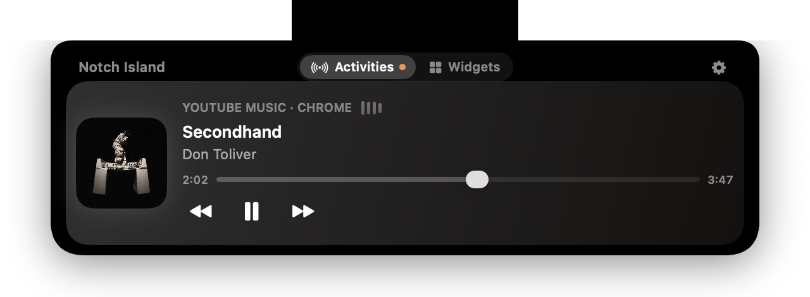
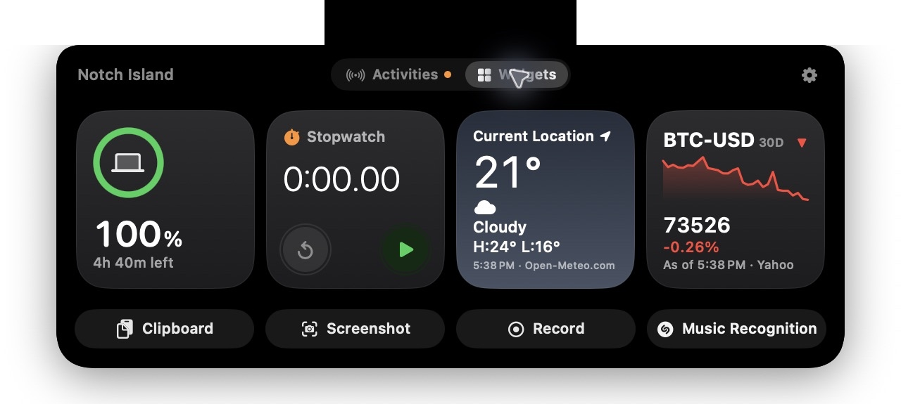
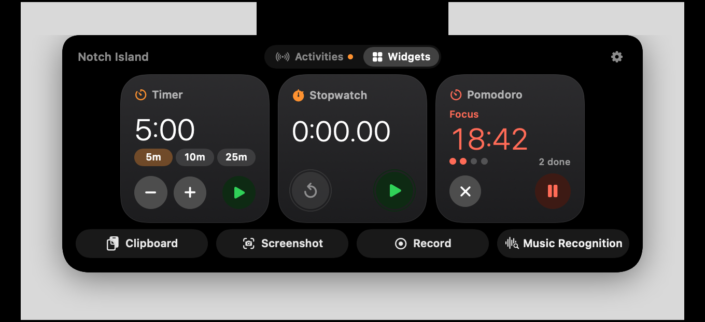

# Notch Island

[繁體中文](README.md) · English

Turn your MacBook notch into a quick place for music, timers, and widgets. Notch Island adapts to the notch dimensions reported by your display and supports English, Traditional Chinese, and Simplified Chinese.

<p align="center"></p>
<p align="center"></p>
<p align="center"></p>
<p align="center"><br><sub>Pomodoro: offline render with sample data, not a screenshot of a real device.</sub></p>

## Features

- **Notch interaction:** click to expand immediately or hover for one second. When idle, the menu bar beside the notch stays clear.
- **Music and activities:** see artwork, track details, and playback progress for supported sources; control playback and seeking. Countdowns, stopwatches and the Pomodoro appear while active; with music playing, music stays on the left and the Pomodoro on the right.
- **Widgets:** choose and arrange up to four widgets, including battery, weather, stocks, clock, calendar, timer, stopwatch, and Pomodoro. Switch between activities and widgets when something is active.
- **Quick actions:** clipboard history, screenshot to clipboard, screen recording, and music recognition (Song Finder by default).
- **Software update:** check GitHub for the latest release on demand. Confirm in Sparkle to download and verify the release, update the installed copy, and relaunch.
- **Power alerts:** see charging status when power is connected and a low-battery reminder with a shortcut to macOS Battery settings.

## Installation

Requires macOS 14 Sonoma or later. Designed for MacBook models with a notch.

1. Visit [Latest Release](https://github.com/LeoFeng0816/Notch-Island/releases/latest) and download `NotchIsland-*.dmg`.
2. Open the DMG, drag **Notch Island** to **Applications**, then eject the DMG.
3. Open Notch Island from Applications. If macOS displays a verification warning, dismiss it with **Done** or **OK**; do not move the app to the Trash.
4. Open **System Settings → Privacy & Security**, scroll to **Security**, and choose **Open Anyway** next to Notch Island. Follow the confirmation prompts. The button is usually available for about an hour after the launch attempt.
5. Complete the first-launch setup. Afterwards, open settings from the Notch Island menu-bar icon.

The app is ad-hoc signed and **not notarized by Apple**. Only if you trust the download, follow [Apple's instructions](https://support.apple.com/en-us/102445) to allow this app individually; you do not need to disable Gatekeeper.

## Using Notch Island

- **Music:** play media from a supported source and expand the island to view and control it. Configure Apple Music, Spotify, and optional YouTube / YouTube Music integration in settings. Browser integration may need Automation permission and browser configuration.
- **Widgets:** select, reorder, or disable widgets in settings; up to four can be shown at once. Weather can use your current location, and stocks can be searched by company or ticker.
- **Pomodoro:** turn it on in **Settings › Widgets**. Focus 25 minutes, short break 5 minutes; after every 4 completed focus sessions the break is a long one (15–30 minutes, default 20, adjustable in Settings or on the Live Activities page). Only a focus that runs its full time counts; pausing, resetting and skipping a break never do. A break starts by itself after a completed focus; the next focus waits for you. Time keeps running while the Mac sleeps and isn't affected by changing the clock. It runs independently of the countdown timer, posts no system notifications, and marks each change with a sound and a short message in the notch.
- **Clipboard:** choose whether to keep history and for how long. Select an item to copy it; automatic paste can be attempted after granting permission to send keystrokes.
- **Screenshots and recording:** screenshots are copied to the clipboard. Recording opens the native macOS recording toolbar, where you start the recording.
- **Music recognition:** uses [Song Finder](https://songfinder.dev) by default, with no account or API key. The first press explains where the audio goes and asks for your consent. A match shows the title and artist, with **Google Search** (artist and title prefilled) and **Copy** (“Artist - Title”). “No match” is shown only when Song Finder says nothing matched; permissions, connectivity, timeouts, rate limits and server errors are reported separately. In settings you can switch to macOS Recognize Music (results stay in Control Center) or AudD (your own API token).
- **Software update:** use **Check for Updates…** from the menu bar or **Settings › Software Update** to see the latest stable GitHub release. Choose **Install Update…** and confirm in Sparkle. Sparkle verifies the Ed25519 signatures on the release feed and DMG, updates the app at its current location, and relaunches it. macOS may ask for an administrator password when updating a protected location.
- **Manual installation:** if you're on v0.1.3 or earlier, install once from the DMG to get in-app updates. If the app is running from the disk image, the release lacks a signed feed, or in-app installation fails, use **Download and Verify**. This checks the size and SHA-256 published by GitHub. Then follow the installation steps above. **Back Up Current App** saves a copy if you want to keep the old bundle. Settings, clipboard history, and Keychain data are preserved. macOS may ask you to grant privacy permissions again for an updated ad-hoc build.
- **Signing:** public releases are ad-hoc signed and unnotarized. Gatekeeper still checks the initial manual installation. In-app updates use an embedded public key to verify the release signature, and Sparkle handles installing verified updates. The SHA-256 published by GitHub checks the integrity of manual downloads.

## Privacy and permissions

Notch Island has no servers of its own. System permissions support the features you choose; clipboard history is stored locally, and calendar data is not transmitted by the app.

**Music recognition (Song Finder, the default) sends audio off this Mac.** The first time you press Music Recognition, a disclosure is shown and nothing is recorded until you agree. After that, each press records about 12 seconds from the microphone and this Mac's sound output (each only if available and allowed by macOS), mixes them into one clip in memory, uploads it once over HTTPS to the third-party service Song Finder (songfinder.dev), and then discards it; nothing is written to disk. The clip contains anything audible, such as nearby voices. According to Song Finder's [privacy policy](https://songfinder.dev/privacy-policy) (updated 2026-08-25), the clip goes to its configured recognition providers (currently ACRCloud, AudioTag and Shazam) and is not retained after recognition; that is Song Finder's statement, which Notch Island cannot verify. Recording and uploading stop when the island closes. You can withdraw consent or choose another method in settings.

Other optional online features: weather sends a city or approximate location to Open-Meteo, and stocks send ticker queries to the quote provider. AudD uploads up to 10 seconds of audio only with your own API key and consent; keys are stored in the macOS Keychain. macOS Recognize Music runs in Control Center under Apple's privacy terms. Checking for updates contacts api.github.com only when you click, and downloads come from GitHub's release files.

When relevant, the app explains permissions for Accessibility, screen and system audio recording, microphone, location, calendar, or Automation. macOS may require permissions to be granted again after updating an ad-hoc build.

## Build from source

With Xcode or Apple Command Line Tools installed, run from the project root:

```bash
./build.sh
open build/NotchIsland.app
```

Run offline tests with `Tests/run_tests.sh`. Run `Tests/run_sparkle_smoke.sh` to test signature failures, cancellation and successful installation with disposable apps. Build the DMG with `scripts/make_dmg.sh`. The build downloads a pinned release of Sparkle, verifies its SHA-256, and bundles the upstream license. The app lives in the menu bar rather than the Dock, where you can open settings or quit.

### Publishing signed updates

Build and verify the DMG with `scripts/make_dmg.sh`, then run `scripts/make_update_feed.sh`. The signing script uses the Sparkle Ed25519 private key in the login Keychain under the account `local.notchisland.release`. macOS may prompt for Keychain access the first time Sparkle's signing tool uses it. Attach both `dist/NotchIsland-<version>.dmg` and `dist/NotchIsland-appcast.xml` to the same stable GitHub Release, tagged `v<version>`. Re-sign the artifacts after rebuilding the DMG.

Increment `CFBundleVersion` with each release and match `CFBundleShortVersionString` to the tag. Keep the release private key out of the repository and release files. Maintainers can back it up with Sparkle's `generate_keys --account local.notchisland.release -x <encrypted-offline-backup-path>` and transfer it using `-f`. Verify your backup before changing Macs or reinstalling macOS. If the key is lost, users of current ad-hoc builds would need to install a new version with a replacement public key manually.

## Donation

If you enjoy Notch Island, you are welcome to support the project. Thank you!

[](https://www.paypal.com/ncp/payment/UY8JAHZCRVDLY)

**Cryptocurrency**

- Stablecoins (USDT, USDC, PYUSD; Solana network): `BCyMirZrcGhcKUonkhykfnUq5pQbeUbXgCQmwJQfjy1o`
- Solana (Solana network): `BnE2VfdgKE2aubg9YpJuPSTFpFgbMawaqcbxXJkff2kL`
- Ethereum (Ethereum network): `0xa8d689b94a54414362b2bd0e6f0cb2a74651f4b0`
- Bitcoin (BTC Taproot): `bc1panr25wetvhl2kyxquu3re6ts4pw6g7fwdul8hpv4shaqu7g9qhyq68twql`
