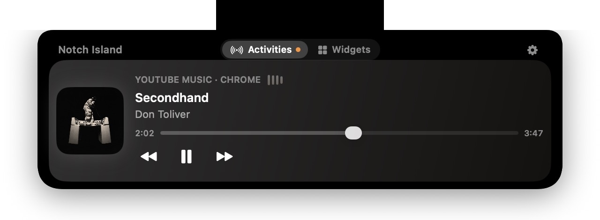
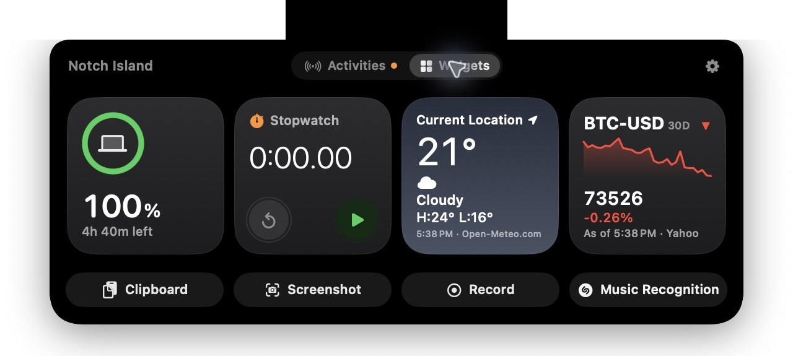

# Notch Island

[繁體中文](README.md) · English

Turn your MacBook notch into a quick place for music, timers, and widgets. Notch Island adapts to the notch dimensions reported by your display and supports English, Traditional Chinese, and Simplified Chinese.

<p align="center"></p>
<p align="center"></p>
<p align="center"></p>

## Features

- **Notch interaction:** click to expand immediately or hover for one second. When idle, the menu bar beside the notch stays clear.
- **Music and activities:** see artwork, track details, and playback progress for supported sources; control playback and seeking. Countdowns and stopwatches appear while active.
- **Widgets:** choose and arrange up to four widgets, including battery, weather, stocks, clock, calendar, timer, and stopwatch. Switch between activities and widgets when something is active.
- **Quick actions:** clipboard history, screenshot to clipboard, screen recording, and music recognition.
- **Power alerts:** see charging status when power is connected and a low-battery reminder with a shortcut to macOS Battery settings.

## Installation

Requires macOS 14 Sonoma or later. Designed for MacBook models with a notch.

1. Visit [Latest Release](https://github.com/LeoFeng0816/Notch-Island/releases/latest) and download `NotchIsland-*.dmg`.
2. Open the DMG, drag **Notch Island** to **Applications**, then eject the DMG.
3. Open Notch Island from Applications. If macOS displays a verification warning, dismiss it with **Done** or **OK**; do not move the app to the Trash.
4. Open **System Settings → Privacy & Security**, scroll to **Security**, and choose **Open Anyway** next to Notch Island. Follow the confirmation prompts. The button is usually available for about an hour after the launch attempt.
5. Complete the first-launch setup. Afterwards, open settings from the Notch Island menu-bar icon.

The app is ad-hoc signed and **not notarized by Apple**. Only if you trust the download, follow [Apple's instructions](https://support.apple.com/en-us/102445) to allow this app individually; you do not need to disable Gatekeeper.

## Using Notch Island

- **Music:** play media from a supported source and expand the island to view and control it. Configure Apple Music, Spotify, and optional YouTube / YouTube Music integration in settings. Browser integration may need Automation permission and browser configuration.
- **Widgets:** select, reorder, or disable widgets in settings; up to four can be shown at once. Weather can use your current location, and stocks can be searched by company or ticker.
- **Clipboard:** choose whether to keep history and for how long. Select an item to copy it; automatic paste can be attempted after granting permission to send keystrokes.
- **Screenshots and recording:** screenshots are copied to the clipboard. Recording opens the native macOS recording toolbar, where you start the recording.
- **Music recognition:** choose macOS Recognize Music or third-party AudD in settings. Follow the Control Center and Accessibility instructions for macOS recognition; for AudD, first provide your key and consent in settings.

## Privacy and permissions

System permissions support the features you choose. The app has no feature that uploads private data to a Notch Island-owned server. Clipboard history is stored locally, and calendar data is not transmitted by the app.

Optional online features send the necessary data to their providers: weather sends a city or approximate location to Open-Meteo, and stocks send ticker queries to the quote provider. AudD requires your own API key and explicit consent before you start and send a short audio sample. Keys are stored in the macOS Keychain. Apple's music recognition services operate under Apple's privacy terms.

When relevant, the app explains permissions for Accessibility, screen and system audio recording, microphone, location, calendar, or Automation. macOS may require permissions to be granted again after updating an ad-hoc build.

## Build from source

With Xcode or Apple Command Line Tools installed, run from the project root:

```bash
./build.sh
open build/NotchIsland.app
```

Run offline tests with `Tests/run_tests.sh`; the DMG packaging script is `scripts/make_dmg.sh`. The app lives in the menu bar rather than the Dock, where you can open settings or quit.

## Donation

If you enjoy Notch Island, you are welcome to support the project. Thank you!

[](https://www.paypal.com/ncp/payment/UY8JAHZCRVDLY)

**Cryptocurrency**

- Stablecoins (USDT, USDC, PYUSD; Solana network): `BCyMirZrcGhcKUonkhykfnUq5pQbeUbXgCQmwJQfjy1o`
- Solana (Solana network): `BnE2VfdgKE2aubg9YpJuPSTFpFgbMawaqcbxXJkff2kL`
- Ethereum (Ethereum network): `0xa8d689b94a54414362b2bd0e6f0cb2a74651f4b0`
- Bitcoin (BTC Taproot): `bc1panr25wetvhl2kyxquu3re6ts4pw6g7fwdul8hpv4shaqu7g9qhyq68twql`
