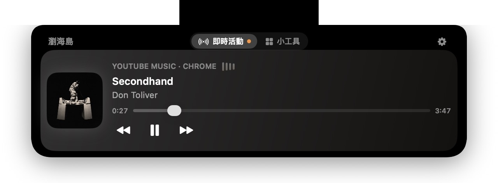
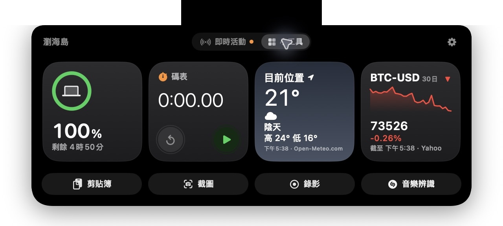
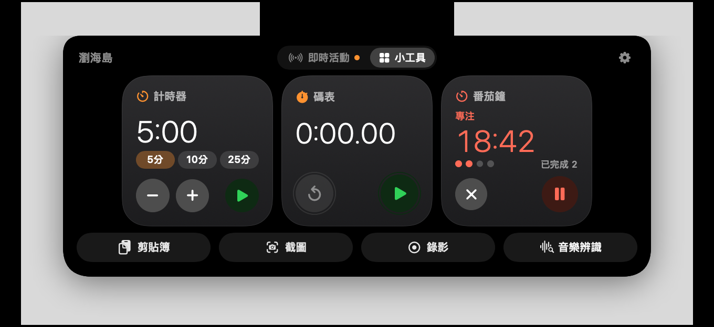

# Notch Island 瀏海島

[English](README.en.md) · 繁體中文

讓 MacBook 的瀏海成為音樂、計時和小工具的快捷入口。Notch Island 會依照螢幕回報的瀏海尺寸調整版面，支援英文、繁體中文與簡體中文。

<p align="center"></p>
<p align="center"></p>
<p align="center"></p>
<p align="center"><br><sub>番茄鐘：離線繪製示意圖（範例資料），非實機截圖。</sub></p>

## 功能

- **瀏海互動**：按一下立即展開，或將游標停留一秒；閒置時保持瀏海兩側的選單列空間。
- **音樂與即時活動**：查看支援來源的曲名、封面和播放進度，操作播放、切歌及進度；倒數計時、碼表和番茄鐘進行時也會顯示在島上；有音樂播放時，音樂在左、番茄鐘在右。
- **小工具**：自選並排列最多四個小工具，包含電池、天氣、股市、時鐘、行事曆、計時器、碼表和番茄鐘。有活動時可在活動與小工具之間切換。
- **快捷操作**：剪貼簿歷史、截圖到剪貼簿、開啟螢幕錄影，以及音樂辨識（預設使用 Song Finder）。
- **軟體更新**：按需檢查 GitHub 最新正式版。你確認後，Sparkle 會下載並驗證簽章、更新目前安裝的副本，再重新啟動。
- **電量提示**：接上電源時顯示充電狀態；電量偏低時提醒，並提供前往 macOS 電池設定的按鈕。

## 安裝

需要 macOS 14 Sonoma 或更新版本；設計給有瀏海的 MacBook 使用。

1. 前往 [Latest Release 最新版本](https://github.com/LeoFeng0816/Notch-Island/releases/latest)，下載 `NotchIsland-*.dmg`。

2. 開啟 DMG，將 **Notch Island** 拖進 **Applications（應用程式）**，再退出 DMG。

**若打開被系統阻擋** :打開「系統設定 → 隱私權與安全性」，捲到「安全性」，在 Notch Island 旁按「仍要打開／強制打開」，並依畫面確認。

3. 在「應用程式」中開啟 Notch Island。若 macOS 顯示無法驗證的警告，按「完成」或「好」關閉提示，**不要移到垃圾桶**。

4.完成首次啟動導覽；之後可從選單列的瀏海島圖示開啟設定。

App 使用 ad-hoc 簽章，**尚未經 Apple 公證**。只在確認下載來源可信時，依 [Apple 官方說明](https://support.apple.com/zh-tw/102445)個別允許；不需要關閉整個 Gatekeeper。

## 使用方式

- **音樂**：播放支援來源的音樂後，展開島即可查看與操作。Apple「音樂」、Spotify 及選用的 YouTube／YouTube Music 整合，可在設定中調整；瀏覽器整合可能需要自動化權限及瀏覽器設定。
- **小工具**：在設定中選擇、排序或關閉小工具；同時最多顯示四個。天氣可使用目前位置，股市可搜尋公司或代號。
- **番茄鐘**：在「設定 › 小工具」開啟。專注 25 分鐘、短休息 5 分鐘；每完成 4 段專注改為長休息（15–30 分鐘，預設 20，可在設定或即時活動頁調整）。只有完整走完的專注才計入；暫停、重設與略過休息都不計。專注完成後休息自動開始，下一段專注等你按下才開始。Mac 睡眠時照常計時，也不受更改系統時鐘影響。與倒數計時器互相獨立；不發送系統通知，只有提示音與瀏海上的短訊息。
- **剪貼簿**：選擇是否保存歷史與保留時間；點選內容可複製，允許傳送按鍵後可嘗試自動貼上。
- **截圖與錄影**：截圖會存到剪貼簿；錄影會開啟 macOS 原生錄影工具列，再由你開始錄製。
- **音樂辨識**：預設使用 [Song Finder](https://songfinder.dev)，不需帳號或金鑰。第一次按下會先說明資料去向並請你同意。辨識成功時顯示曲名與歌手，可按「Google 搜尋」以歌手與曲名搜尋，或按「複製」複製「歌手 - 曲名」。只有 Song Finder 明確回覆沒有符合時才顯示找不到；權限、網路、逾時、限流與伺服器錯誤會分別說明。設定中也可改用 macOS 辨識音樂（結果留在控制中心）或 AudD（需要你自己的金鑰）。
- **軟體更新**：從選單列「檢查更新…」或「設定 › 軟體更新」查看 GitHub 最新正式版。按「安裝更新…」並在 Sparkle 的視窗確認後，Sparkle 會驗證同一發行版的更新清單及 DMG 的 Ed25519 簽章，在原安裝位置更新 App，然後重新啟動。在某些位置可能需要提供管理員密碼。
- **手動安裝**：v0.1.3 或更早版本請先用 DMG 安裝一次。若目前從 DMG 執行、發行版缺少已簽章的更新清單，或更新無法在 App 內安裝，可選「下載並驗證」，核對 GitHub 公布的檔案大小與 SHA-256，再依上方步驟手動安裝。需要保留舊版時可選「備份目前的 App」。設定、剪貼簿紀錄與鑰匙圈資料保留。ad-hoc 版本更新後，macOS 可能要求重新授予部分隱私權限。
- **簽章**：公開版使用 ad-hoc 程式簽章，未經 Apple 公證。初次手動安裝仍會經過 macOS 的 Gatekeeper 檢查。App 內更新另外使用 App 隨附的公開金鑰驗證發行檔，由 Sparkle 處理已驗證的安裝。GitHub 提供的 SHA-256 用於手動下載的完整性核對。

## 隱私與權限

Notch Island 沒有自己的伺服器。系統權限只用於你選擇的功能；剪貼簿歷史儲存在本機，行事曆資料不會由本 App 傳出。

**音樂辨識（預設 Song Finder）會把音訊傳出這台 Mac。** 第一次按「音樂辨識」時會先顯示說明，你同意前不會錄音。之後每次按下，App 會錄下約 12 秒的麥克風與 Mac 聲音輸出（各自只在可用且 macOS 允許時），在記憶體中合成一個片段，以 HTTPS 上傳一次到第三方服務 Song Finder（songfinder.dev），之後丟棄，不寫入磁碟。片段包含所有聽得到的聲音，例如附近的人聲。依 Song Finder 的[隱私權政策](https://songfinder.dev/privacy-policy)（2026-08-25 版），片段會交給它設定的辨識服務商（目前列出 ACRCloud、AudioTag、Shazam），辨識後不保留；這是 Song Finder 的說法，Notch Island 無法查證。島關閉時會停止錄音與上傳；可在設定中撤回同意或改用其他方式。

其他選用的網路功能：天氣向 Open-Meteo 傳送城市或概略位置，股市向報價服務傳送代號；AudD 需你自己的金鑰並同意後，才會上傳最多 10 秒音訊，金鑰存於 macOS 鑰匙圈；macOS 辨識音樂在控制中心進行，依 Apple 的隱私條款運作。檢查更新只在你按下時連線 api.github.com，下載來自 GitHub 的發行檔案。

各功能所需的輔助使用、螢幕與系統音訊錄製、麥克風、定位、行事曆或自動化權限，會在相關操作時說明。更新 ad-hoc 版本後，macOS 可能需要重新授權。

## 從原始碼建置

安裝 Xcode 或 Apple Command Line Tools 後，在專案根目錄執行：

```bash
./build.sh
open build/NotchIsland.app
```

執行離線測試使用 `Tests/run_tests.sh`。可用 `Tests/run_sparkle_smoke.sh` 以臨時假 App 測試簽章失敗、取消和成功更新。建立 DMG 使用 `scripts/make_dmg.sh`。建置會從 Sparkle 官方發行頁下載固定版本，核對 SHA-256，並附上授權資訊。App 不會顯示在 Dock，請從選單列開啟設定或結束。

### 發布簽章更新

先以 `scripts/make_dmg.sh` 建置並驗證 DMG，再執行 `scripts/make_update_feed.sh`。後者會使用登入鑰匙圈內帳號為 `local.notchisland.release` 的 Sparkle Ed25519 私鑰簽署 DMG 與更新清單。首次使用 Sparkle 的簽章工具時，macOS 可能會要求鑰匙圈存取授權。把 `dist/NotchIsland-<版本>.dmg` 和 `dist/NotchIsland-appcast.xml` 附加到同一個 GitHub 正式 Release，標籤為 `v<版本>`。重新建置 DMG 後須重新簽署。

每次發版增加 `CFBundleVersion` 並保持與 `CFBundleShortVersionString`、GitHub 標籤的對應。正式私鑰不放在儲存庫或發布檔。維護者可使用 Sparkle 的 `generate_keys --account local.notchisland.release -x <加密離線備份路徑>` 備份，換機時用 `-f` 匯入。請在移轉或重裝前確認備份可用。失去原金鑰時，現行 ad-hoc 版本的使用者需要手動安裝帶有新公鑰的版本。

## 捐款 Donation

如果你喜歡 Notch Island，歡迎支持這個專案。感謝你的支持！

[](https://www.paypal.com/ncp/payment/UY8JAHZCRVDLY)

**加密貨幣**

- 穩定幣（USDT、USDC、PYUSD；Solana 網路）：`BCyMirZrcGhcKUonkhykfnUq5pQbeUbXgCQmwJQfjy1o`
- Solana（Solana 網路）：`BnE2VfdgKE2aubg9YpJuPSTFpFgbMawaqcbxXJkff2kL`
- Ethereum（Ethereum 網路）：`0xa8d689b94a54414362b2bd0e6f0cb2a74651f4b0`
- Bitcoin（BTC Taproot）：`bc1panr25wetvhl2kyxquu3re6ts4pw6g7fwdul8hpv4shaqu7g9qhyq68twql`
