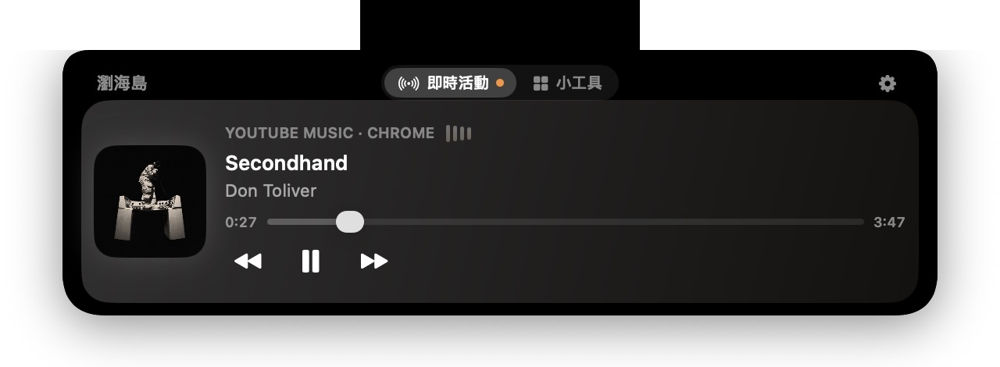
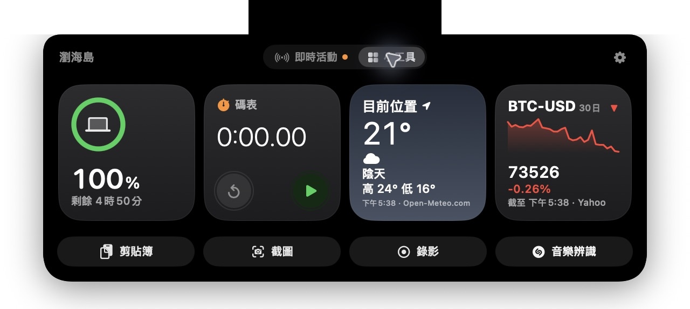

# Notch Island 瀏海島

[English](README.en.md) · 繁體中文

讓 MacBook 的瀏海成為音樂、計時和小工具的快捷入口。Notch Island 會依照螢幕回報的瀏海尺寸調整版面，支援英文、繁體中文與簡體中文。

<p align="center"></p>
<p align="center"></p>
<p align="center"></p>

## 功能

- **瀏海互動**：按一下立即展開，或將游標停留一秒；閒置時保持瀏海兩側的選單列空間。
- **音樂與即時活動**：查看支援來源的曲名、封面和播放進度，操作播放、切歌及進度；倒數計時和碼表進行時也會顯示在島上。
- **小工具**：自選並排列最多四個小工具，包含電池、天氣、股市、時鐘、行事曆、計時器和碼表。有活動時可在活動與小工具之間切換。
- **快捷操作**：剪貼簿歷史、截圖到剪貼簿、開啟螢幕錄影，以及音樂辨識。
- **電量提示**：接上電源時顯示充電狀態；電量偏低時提醒，並提供前往 macOS 電池設定的按鈕。

## 安裝

需要 macOS 14 Sonoma 或更新版本；設計給有瀏海的 MacBook 使用。

1. 前往 [Latest Release 最新版本](https://github.com/LeoFeng0816/Notch-Island/releases/latest)，下載 `NotchIsland-*.dmg`。
2. 開啟 DMG，將 **Notch Island** 拖進 **Applications（應用程式）**，再退出 DMG。
3. 在「應用程式」中開啟 Notch Island。若 macOS 顯示無法驗證的警告，按「完成」或「好」關閉提示，**不要移到垃圾桶**。
4. 打開「系統設定 → 隱私權與安全性」，捲到「安全性」，在 Notch Island 旁按「仍要打開／強制打開」，並依畫面確認。此按鈕通常在嘗試開啟後約一小時內出現。
5. 完成首次啟動導覽；之後可從選單列的瀏海島圖示開啟設定。

App 使用 ad-hoc 簽章，**尚未經 Apple 公證**。只在確認下載來源可信時，依 [Apple 官方說明](https://support.apple.com/zh-tw/102445)個別允許；不需要關閉整個 Gatekeeper。

## 使用方式

- **音樂**：播放支援來源的音樂後，展開島即可查看與操作。Apple「音樂」、Spotify 及選用的 YouTube／YouTube Music 整合，可在設定中調整；瀏覽器整合可能需要自動化權限及瀏覽器設定。
- **小工具**：在設定中選擇、排序或關閉小工具；同時最多顯示四個。天氣可使用目前位置，股市可搜尋公司或代號。
- **剪貼簿**：選擇是否保存歷史與保留時間；點選內容可複製，允許傳送按鍵後可嘗試自動貼上。
- **截圖與錄影**：截圖會存到剪貼簿；錄影會開啟 macOS 原生錄影工具列，再由你開始錄製。
- **音樂辨識**：設定中可選擇 macOS 辨識音樂或第三方 AudD。使用系統辨識時依提示設定控制中心與輔助使用權限；使用 AudD 時先在設定中提供金鑰並同意資料處理。

## 隱私與權限

系統權限只用於你選擇的功能，程式沒有將私人資料上傳到 Notch Island 自有伺服器的功能。剪貼簿歷史儲存在本機，行事曆資料不會由本 App 傳出。

選用的網路功能會向各自服務提供必要資料：天氣向 Open-Meteo 傳送城市或概略位置，股市向報價服務傳送代號；使用 AudD 前需自行提供金鑰、同意並主動開始，才會傳送短音訊。金鑰存於 macOS 鑰匙圈。辨識音樂的 Apple 服務依 Apple 的隱私條款運作。

各功能所需的輔助使用、螢幕與系統音訊錄製、麥克風、定位、行事曆或自動化權限，會在相關操作時說明。更新 ad-hoc 版本後，macOS 可能需要重新授權。

## 從原始碼建置

安裝 Xcode 或 Apple Command Line Tools 後，在專案根目錄執行：

```bash
./build.sh
open build/NotchIsland.app
```

執行離線測試使用 `Tests/run_tests.sh`；建立 DMG 的腳本位於 `scripts/make_dmg.sh`。App 不會顯示在 Dock，請從選單列開啟設定或結束。

## 捐款 Donation

如果你喜歡 Notch Island，歡迎支持這個專案。感謝你的支持！

[](https://www.paypal.com/ncp/payment/UY8JAHZCRVDLY)

**加密貨幣**

- 穩定幣（USDT、USDC、PYUSD；Solana 網路）：`BCyMirZrcGhcKUonkhykfnUq5pQbeUbXgCQmwJQfjy1o`
- Solana（Solana 網路）：`BnE2VfdgKE2aubg9YpJuPSTFpFgbMawaqcbxXJkff2kL`
- Ethereum（Ethereum 網路）：`0xa8d689b94a54414362b2bd0e6f0cb2a74651f4b0`
- Bitcoin（BTC Taproot）：`bc1panr25wetvhl2kyxquu3re6ts4pw6g7fwdul8hpv4shaqu7g9qhyq68twql`
