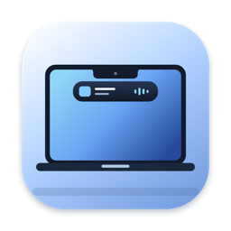

# Notch Island（瀏海島）

[English](README.en.md) · 繁體中文

Notch Island 是以 Swift、AppKit 與 SwiftUI 製作的 macOS 瀏海區域工具，可顯示音樂播放與計時活動，並提供天氣、電池、股票、時鐘、行事曆等小工具及快捷功能，支援英文、繁體與簡體中文。部分整合需要系統權限，也有待進一步實機測試。

這是範圍明確的實作，**並非** iPhone 動態島的完整複製：macOS 沒有公開 API 讓第三方 App 讀取 iPhone 或其他 App 的 Live Activities，所以這裡的「即時活動」只有本 App 自己的倒數計時、碼表，以及支援來源的播放狀態（「音樂」、Spotify，及選用的 Chrome／Safari YouTube／YouTube Music）；沒有通知攔截或其他第三方 App 整合。



> **v0.1.0 是第一個公開版本。** 安裝檔使用 ad-hoc 簽章，**沒有 Developer ID 簽章，也沒有經過 Apple 公證**，第一次開啟會被 macOS 阻擋，請依下方「[安裝](#安裝)」的 Apple 官方步驟個別允許。不建議停用 Gatekeeper。尚未實機驗證的功能列在「[已知限制](#已知限制)」。發行說明見 [docs/RELEASE-NOTES-v0.1.0.md](docs/RELEASE-NOTES-v0.1.0.md)。

## 功能

| 狀態 | 行為 |
| --- | --- |
| 閒置 | 黑色區塊與硬體瀏海完全重疊，瀏海兩側的選單列保持空出，點擊會穿透到選單列。啟用區＝實體瀏海＋瀏海**正下方 8 pt 的細條**（硬體瀏海在某些機型上不一定點得到）；游標進入時島嶼向下長 6 pt，讓這塊目標看得見。 |
| 活動中（compact） | 只有在倒數計時進行中／暫停／時間到，或音樂正在播放時，才在瀏海左右兩側顯示小型內容：左側為專輯封面或計時器圖示，右側為倒數時間或音樂律動條。點一下即可展開。 |
| 展開 | 在啟用區**按一下左鍵立即展開**；或游標停在啟用區（或 compact 區域）上 **1 秒** 後，面板從瀏海**下方**以彈簧動畫向下長出；標題列、分頁切換與設定按鈕都在選單列下方的面板內（語言只在設定視窗切換）。**展開時選單列內只覆蓋實體瀏海**：即使有即時活動，瀏海左右的 compact 指示也會收起，讓旁邊的選單列狀態圖示保持可見、可點（即時資訊改在面板內顯示）；收合後指示區才回來。游標離開或點擊外部即收合。 |
| 展開：小工具 | **沒有即時活動時**，展開後預設顯示「小工具」頁（電池、天氣、股價、計時器、碼表、行事曆、時鐘，可自由開關與排序，同時最多 4 個）。**有即時活動時**預設顯示「即時活動」頁，可用面板上方的「即時活動／小工具」切換；切到小工具時，瀏海兩側的 compact 指示仍保留。 |

### 選單列不被佔用

- 在選單列高度內，島嶼只會畫在實體瀏海範圍內；只有計時或音樂進行中時，才會加上 compact 左右兩側的指示區。展開時也一樣，其他選單列區域保持透明、可點擊，陰影也被遮罩在選單列下方。
- 島嶼形狀由「頸部」（選單列內，寬度＝瀏海或 compact 指示區）與「主體」（永遠從選單列下緣開始）組成，兩者用同一個可動畫的形狀描述，所以展開／收合的中間動畫也不會蓋到選單列。
- 滑鼠點擊判定使用與繪製相同的路徑：外側圓角、頂端外擴弧線以外的區域都會穿透到底下的選單列或視窗。閒置時只有游標在「瀏海＋正下方 8 pt 細條」內，面板才接收點擊（點一下立即展開）；瀏海左右的選單列，以及細條以外的地方，一律穿透。若點擊在面板切換成可點之前就送到別的 App，全域點擊監聽仍會立即展開。這些規則有自動化點擊判定測試。

- **小工具不會佔用選單列**：小工具只畫在選單列下方的面板內；選單列中只有實際的即時活動（計時、碼表、音樂）才會讓瀏海兩側出現指示區。這點有自動化測試覆蓋（點擊判定：瀏海左右的選單列點擊會穿透）。

### 即時活動

- **倒數計時器**：**沒在跑時放在「計時器」小工具**（5／10／25 分鐘預設、±1 分鐘、開始），開始後才成為即時活動（瀏海兩側指示＋「即時活動」頁的計時器面板，可暫停／繼續／重設）；「即時活動」頁只顯示正在執行的計時器／碼表，兩者都沒在跑時只顯示音樂。選單列圖示也可「開始 5 分鐘計時」。舊使用者若小工具未滿 4 個，第一次啟動新版會自動加入計時器小工具一次（之後關閉不會再被加回；已滿 4 個則不會擠掉既有選擇）。以系統時鐘計算（不受 UI 卡頓影響），時間到會播放提示音並在瀏海上顯示「完成」約 12 秒。上次選擇的時長會被記住。
- **碼表**：開始／暫停／繼續／分圈／重設，以系統時鐘計算；狀態（含分圈，最多 50 筆）存在本機，**結束 App 再開啟會繼續計時**。執行中或暫停時，瀏海右側以青色顯示經過時間；可在展開面板「即時活動」頁的「計時器／碼表」切換、碼表小工具，或選單列圖示選單操作。
- **音樂整合**：支援 Apple「音樂」與 Spotify，顯示曲名、演出者、封面、播放進度，並可上一首／播放暫停／下一首。只在播放器已開啟時才查詢，不會主動啟動播放器。
- **瀏覽器媒體（選用，預設關閉）**：Google Chrome 與 Safari 中的 **YouTube Music**（`https://music.youtube.com/…`，含 Chrome 安裝的 YouTube Music 網頁 App／PWA，其起始網址為 `https://music.youtube.com/?source=pwa`）與 **YouTube** 影片（`https://www.youtube.com/watch?…`、`/shorts/…`、`m.youtube.com`）。顯示 Media Session 提供的真實曲名／演出者／封面、播放中或暫停、進度，並可播放／暫停、下一首、上一首（YouTube 沒有播放清單時，「上一首」會回到影片開頭）。只有真正播放中的分頁才會成為瀏海兩側的即時活動；暫停的分頁只在之前顯示過時保留在面板內。詳見下方「瀏覽器媒體設定」。
- **介面語言**：English／繁體中文／简体中文，**只在設定視窗（一般 › 語言）切換**（展開島上的語言按鈕與選單列的語言子選單已移除），預設跟隨系統；所有小工具、錯誤訊息、設定視窗與時間格式都會立即切換。

### 小工具

在選單列圖示 › **設定…**（⌘,）或展開面板的齒輪開啟設定視窗：


| 小工具 | 資料來源 | 會連網嗎 | 說明 |
| --- | --- | --- | --- |
| 電池 | IOKit `IOPowerSources`（公開 API） | 否 | 電量百分比、充電中／已接電源未充電／使用電池、macOS 估算的剩餘或充飽時間（估算中時顯示「估算中」，不顯示假數字）、低耗電模式。電源變化即時更新。桌上型 Mac 顯示「沒有電池」。 |
| 天氣 | [Open-Meteo](https://open-meteo.com/)（免金鑰） | 是 | 目前溫度、天氣狀況、今日高低溫、更新時間；每 30 分鐘自動更新，可手動重新整理（最快每分鐘一次）。°C／°F 可選。 |
| 股價 | 預設 **Yahoo Finance**（非官方、免金鑰）；可改用 [Alpha Vantage](https://www.alphavantage.co/documentation/#daily) `TIME_SERIES_DAILY`（官方文件、需免費 API 金鑰） | 是 | 最多 3 個代號（例如 `AAPL`、`2330.TW`、`^GSPC`、`EURUSD=X`）。Yahoo：顯示價格、相對前一個實際收盤的漲跌與**交易所回報的確切時間**（當天顯示時間，否則顯示日期＋時間），每 15 分鐘自動更新、手動最快每分鐘一次。Alpha Vantage：顯示最新每日收盤價、相對前一日收盤的漲跌幅與「截至」最近交易日；只有 1 個代號時另畫**最近 30 個實際收盤價**的走勢圖（標示「30日」）。每 3 小時自動更新，手動最快每 5 分鐘一次。 |
| 碼表 | 本機 | 否 | 同上「碼表」。 |
| 行事曆 | EventKit（macOS 14 `requestFullAccessToEvents`） | 否 | 參考 iOS「行事曆」：紅色星期、大字日期、接下來最多 2 個活動（行事曆顏色條、標題、當地時間；明天／星期幾／全天／「進行中，至 …」），超過時顯示「另有 N 項」。範圍可選今天／未來 3 天／未來 7 天，可隱藏全天活動。沒有活動時如實顯示「今天沒有活動」。**只有按下「允許存取行事曆」（設定或卡片）時才會請求權限**；拒絕或只有「僅限加入」權限時顯示原因並可開啟系統設定。活動只存在記憶體，不寫入磁碟、不傳出。 |
| 時鐘 | 本機 | 否 | 沒有加入時區時顯示 iOS「時鐘」風格的指針錶（橘色秒針）與本地時間；可再加入最多 2 個時區（設定中搜尋 IANA 時區，例如 `new york`），以清單顯示城市、今天／明天／昨天與時差、時間。城市名稱來自時區識別碼（英文），因為 macOS 沒有公開的在地化城市名稱 API。 |

- 預設只開啟**不需網路**的電池與碼表；天氣與股價在設定裡標示「會連網」，行事曆標示「需要授權」，都需使用者自行開啟。同時最多開啟 4 個小工具（卡片是正方形，4 張剛好並排）；已滿時再開第 5 個，會跳出三語說明視窗（例如「『行事曆』沒有加入，因為島嶼一次最多並排顯示 4 個小工具。目前開啟：電池、天氣、計時器、碼表。請先關閉其中一個，再重新開啟這個小工具。」），開關不會被單純停用；舊設定若超過 4 個會依排序保留前 4 個。
- 開關以切換鈕控制；排序可拖曳列，或使用每列的 ↑／↓ 按鈕。所有設定存在本機 `UserDefaults`，重開 App 後保留。
- **卡片外觀（參考 iOS 小型 widget）**：每張卡都是連續圓角的正方形，大小依島嶼寬度自動計算（最多 4 張並排）。天氣卡的天空漸層依實際天氣代碼與白天／夜晚切換，大字溫度、城市、狀況與高低溫排列方式參考 iOS「天氣」；電池卡用 iOS「電池」小工具式的圓環（綠色、低耗電黃色、20% 以下紅色，充電時顯示閃電）；股價卡參考 iOS「股市」，1 個代號時顯示走勢圖，2–3 個代號時顯示清單與紅綠漲跌標籤；碼表卡參考 iOS「時鐘」（細體數字、灰色分圈／重設鍵、綠色開始／紅色停止）。載入中用 iOS 式的遮罩佔位（不顯示任何數字）；圓環與走勢圖有進場動畫，數字改變時有數字轉場；啟用「減少動態效果」時會略過動畫。每張卡都有完整的 VoiceOver 描述（三種語言）。
- 點一下天氣／股價卡會手動重新整理；股價尚未設定時點一下會開啟設定。
- **天氣不必先輸入城市**：在設定中開啟天氣小工具、且尚未選城市時，會立即請求**概略**位置（macOS 的定位權限提示只在這個時候出現）；在島嶼上點一下尚未設定的天氣卡也會請求。允許後用目前位置取得天氣；拒絕、定位服務關閉、逾時（20 秒）或網路錯誤時，卡片與設定會顯示原因與「開啟系統設定」，也可以改用城市搜尋。設定中隨時可按「使用目前位置／更新位置」或「清除」。
- **這些是 Notch Island 自己畫的小工具**，不是 iOS／WidgetKit 小工具，也無法放入 iPhone 或其他 App 的小工具。
- **任何資料來源失敗時**（離線、逾時、伺服器錯誤、達到請求上限、金鑰無效、找不到城市／代號、回傳格式異常），小工具會顯示黃色「無法取得」與原因，絕不顯示預設或假造的數值；載入中顯示「載入中…」。部分代號失敗時，成功的代號照常顯示，失敗的那列標示「無法取得」。
- 天氣小工具顯示「Open-Meteo.com」出處（CC BY 4.0 要求的署名）；股價小工具在底部標示資料來源（Yahoo／Alpha Vantage）與「截至」時間。


#### 資料來源細節與限制

- **Open-Meteo**：城市搜尋使用 `geocoding-api.open-meteo.com/v1/search`，天氣使用 `api.open-meteo.com/v1/forecast`（`current` + `daily`，`timezone=auto`）。官方免費方案限非商業用途並要求署名；若用於商業用途需另行取得授權。
- **Alpha Vantage**：有正式文件的 REST API。每個代號只發 1 次 `TIME_SERIES_DAILY` 請求，同時取得最新收盤、前一日收盤（計算漲跌）與走勢圖用的歷史收盤，所以畫圖**不會多耗配額**；走勢圖只用回傳的實際收盤價畫，資料少於 2 筆就不畫。免費金鑰目前每天約 25 次請求、每秒約 1 次，所以最多 3 個代號、每 3 小時更新一次，請求之間間隔 1.2 秒；遇到請求上限或金鑰錯誤會立即停止後續請求。免費資料是**每日收盤，不是即時報價**（以「截至 11月6日」標示最近交易日）。支援的市場以 Alpha Vantage 為準（美股如 `AAPL`，部分海外市場使用後綴，例如 `TSCO.LON`）；**台股（如 2330）不一定有資料**，查無資料時會顯示「找不到」。
- **Yahoo Finance（預設）**：使用 `https://query1.finance.yahoo.com/v8/finance/chart/<代號>?range=3mo&interval=1d`，每個代號 1 次請求，取得 `regularMarketPrice`、`regularMarketTime`（作為「截至」時間）、幣別與每日收盤（走勢圖只用回傳的非空收盤；漲跌＝價格 − 價格所在交易日之前的最後一個實際收盤）。**這是非官方、沒有文件的端點**：Yahoo 隨時可能限流（HTTP 429）、更改或封鎖；報價依交易所延遲（通常 15–20 分鐘）或為收盤價，**不保證正確或即時**，請勿用於交易決策。請求使用 App 自己的 User-Agent（`NotchIsland/0.1`），不冒充瀏覽器、不帶 cookie、不需要也不讀取任何金鑰；代號只允許字母、數字與 `.-^=`，並以路徑編碼（`^`→`%5E`、`=`→`%3D`）。2026-11-07 實測：`2330.TW` 2135 TWD −4.69%、`AAPL` 342.37 USD −0.52%（與 Yahoo 回報值一致）；同一天也遇到短暫的 429，App 會顯示「已達請求上限，請稍後再試」。查無代號時 Yahoo 回 404 與 `Not Found`，顯示「找不到」。
- 曾評估過 Stooq（端點已失效）。Alpha Vantage 保留為有正式文件的選項。

### 隱私

- **定位服務只在你要求時使用**：啟動時不會建立 `CLLocationManager`、不會詢問權限；只有在開啟天氣小工具（且尚未選城市）、點擊天氣卡，或按「使用目前位置」時才會請求。要求的是降低精確度（`kCLLocationAccuracyReduced`）的單次定位（`requestLocation`），不會持續追蹤。結果先**四捨五入到 0.1°（約 11 公里）**才儲存到本機偏好設定並送到 Open-Meteo，精確座標不會保存或傳出，也不做反向地理編碼。
- 城市搜尋：按下「搜尋」時才把輸入的文字送到 Open-Meteo 地理編碼；之後只有在天氣小工具開啟時，才會把所選城市的經緯度送到 Open-Meteo。
- **行事曆**：只在按下「允許存取行事曆」時請求完整存取權；活動只存在記憶體，不寫入磁碟、不傳出；小工具關閉時不讀取行事曆。
- **瀏覽器媒體**：預設關閉。開啟後由瀏覽器自己的 AppleScript 在瀏覽器內篩選分頁，**只有網址以白名單前綴開頭的分頁才會回傳**，其他分頁的網址與標題不會進入本 App；回傳後再以 `URLComponents` 檢查 HTTPS 與主機名稱。只執行固定的 JavaScript 片段（讀取 Media Session 與主要 `<video>`／`<audio>` 狀態；控制時按播放列按鈕或呼叫 play／pause），而且執行控制前會在同一段腳本中再次確認該分頁網址。不記錄、不儲存瀏覽紀錄。封面只從 `*.ytimg.com`、`*.googleusercontent.com`、`*.ggpht.com` 以 HTTPS、ephemeral session 下載。
- 天氣／股價小工具關閉、或尚未設定城市／代號／金鑰時，**完全不連網**（有自動化測試驗證請求次數為 0）。電池、碼表、計時器、音樂都不連網。
- Alpha Vantage 金鑰存在 macOS **鑰匙圈**（generic password，service `local.notchisland.alphavantage`；其他 bundle ID 的預覽副本使用 `<bundle ID>.alphavantage`，不會碰到正式 App 的項目），不寫入偏好設定檔、不顯示在介面或錯誤訊息中。
- 金鑰在背景執行緒讀取且不主動跳出驗證畫面，最多等 5 秒；鑰匙圈鎖定或正在等待「允許存取」時，股價卡顯示「無法從鑰匙圈讀取 API 金鑰（已鎖定或等待授權）」，不會卡住島嶼，也不會在沒有金鑰的情況下發出請求。注意：`build.sh` 是 ad-hoc 簽章，重新建置後 macOS 可能詢問是否允許讀取鑰匙圈項目，按「一律允許」後點一下股價卡即可重新整理。
- 網路請求使用 ephemeral `URLSession`（不存 cookie、不寫磁碟快取）。
- **無瀏海螢幕**：閒置時選單列上什麼都不畫，只在選單列正中央保留一塊 110 pt 寬的隱形懸停區（游標進入時會出現一個小標籤作為提示）。展開後面板浮在選單列下方 6 pt；計時或音樂進行中時，compact 指示區會出現在選單列中央，並與面板相連。

### 快捷功能

展開島嶼的「小工具」頁下方有四個按鈕：

- **剪貼簿**：在島內切到剪貼簿頁（左上 ✕ 返回、右上紅色垃圾桶按兩下清空）。**預設關閉**，按「開啟」或在設定／歡迎導覽中開啟後才開始記錄。最多 50 筆（文字 ≤ 100 KB、圖片 ≤ 8 MB、≤ 20 個檔案，超過的不保存、不截斷），保存期限可選 1／3／7／30 天（預設 3 天），每小時與啟動時自動刪除過期紀錄及其圖片檔。只存在 `~/Library/Application Support/NotchIsland/Clipboard`（目錄 0700、檔案 0600），不上傳、不寫入日誌。標記為 `org.nspasteboard.ConcealedType`／`TransientType`／`AutoGeneratedType`、1Password 等類型，或從密碼管理器（Passwords、鑰匙圈存取、1Password、Bitwarden 等）複製的內容一律不保存。只能以輪詢 `changeCount` 偵測變化（macOS 沒有剪貼簿通知 API）。
  - 點一下紀錄：先放回剪貼簿，再回到**展開島嶼前的前景 App** 並送出 ⌘V（島嶼本身是不會搶焦點的面板）。這需要「傳送按鍵」權限（列在「輔助使用」，只在你按「允許」時請求）；沒有權限、找不到原本的 App 或焦點無法回到該 App 時，只會顯示「已複製」並提示按 ⌘V，不會假裝已貼上。macOS 不會回報目標 App 是否接受貼上，所以「已貼上」代表已送出 ⌘V。
- **截圖**：收合島嶼後執行系統的 `screencapture -i -J selection -c`（由你框選區域或視窗，Esc 取消），結果複製到剪貼簿。結果只依 `screencapture` 的**實際**結束狀態、診斷文字與剪貼簿是否真的出現新圖片判斷，診斷文字比對的是 macOS 27 `/usr/sbin/screencapture` 內的原文（如 `could not create image from rect`、`screencapture not allowed`、`No selection to capture. Cancelling`）：
  - 出現新圖片 →「已複製」；安靜結束但沒有新圖片或工具自己說取消 →「已取消」。**取消永遠不會被當成權限問題**，即使 macOS 回報未授權。
  - 工具明確拒絕或讀不到畫面時，才會開說明視窗，內容依序為工具回報的事實、依證據強弱給的解釋、可用的替代方式（macOS「截圖」工具列、隱私權設定）。其他未知錯誤只顯示狀態碼，不推測是權限。
- **錄影**：只有 macOS 回報「目前這份」瀏海島有「螢幕與系統錄音」權限時，按鈕才直接開啟 `screencapture -i -U -J video -p` 工具列，並已切到**錄影模式**。在你按「錄製」之前不會開始錄影；錄製、停止與儲存由 macOS 處理。沒有權限時不會勉強開啟（可能只錄到桌面），而是說明原因並提供三種選擇：
  1. **用 QuickTime 錄影**：送 `new screen recording` 給 QuickTime Player，由 QuickTime 開啟同一個錄影工具列。QuickTime 自帶系統的螢幕擷取權限（entitlement `com.apple.private.tcc.allow` 含 `kTCCServiceScreenCapture`），因此只需要 macOS 在第一次詢問你是否允許瀏海島控制 QuickTime；拒絕時會說明並改提供「截圖」。
  2. **開啟「截圖」**：Screenshot.app 固定以 `-uUpi` 啟動，會停在你上次使用的模式（可能是截圖）。島嶼會提示你按「錄製整個螢幕」或「錄製所選部分」（帶圓點的螢幕圖示），再按「錄製」。
  3. **開啟隱私權設定**。[Apple 的螢幕錄影說明](https://support.apple.com/en-us/102618)
- **Shazam** 開啟音訊來源選擇。選擇「這台 Mac 的聲音」（macOS 14.2 以上）或「麥克風」後才會開始辨識。macOS 可能詢問該音源的權限。一次只使用選定的來源，最多 30 秒，關閉瀏海島即可停止。ShazamKit 會將音訊特徵送到 Apple 曲庫進行比對。辨識失敗時，畫面會區分服務錯誤與找不到歌曲。
  - **錯誤處理**：靜音或太短的片段（ShazamKit 200／201）視為「還沒有可用的聲音」，繼續聆聽。依 SDK `SHSession.h`「與曲庫伺服器通訊的問題可以重試」，錯誤 202／500／600 與網路錯誤會在 30 秒內持續重試，時間到才顯示該錯誤；聆聽中遇到 202 會立即顯示「仍在重試」。其他錯誤（音訊格式、自訂曲庫、未知錯誤碼）立即停止。
  - 在 macOS 27.0.1 以相同的 12 秒合成音訊特徵測試。本機自訂曲庫配對成功，ad-hoc App 查詢 Apple 曲庫則回傳 ShazamKit 202。系統日誌顯示該 App ID 的媒體權杖請求失敗，曲庫請求最後回 HTTP 401。Apple 要求在註冊的 App ID 啟用 ShazamKit 服務才能查詢 Apple 曲庫。還需要在有自有團隊簽章和已啟用服務的版本重測，才能確認 Apple 帳號端設定與成功辨識。[ShazamKit 開發者文件](https://developer.apple.com/shazamkit/) · [App ID 啟用說明](https://developer.apple.com/help/account/services/shazamkit/)
  - **用 macOS 辨識音樂（免費）**：按下後，瀏海島以輔助使用 API 替你按控制中心的「辨識音樂」。程序是：已釘選的選單列「辨識音樂」或「控制中心」→ 模組 `controlcenter-musicrecognition` → 面板內的「開始聆聽」，接著讀到控制中心顯示「聆聽中」才回報「macOS 正在聆聽」。識別碼取自 macOS 27 ControlCenter 二進位內的字串，按鈕與狀態文字在執行時讀取系統的 `MusicRecognition.loctable`（所有語言）。只按**唯一**辨認出的控制項，有多個或找不到就不按，也不使用座標。按了但讀不到聆聽狀態時，只顯示「無法確認」。需要輔助使用權限，沒有時會說明並提供「打開設定」，不會自動授權。由 macOS 聆聽，結果顯示在控制中心，不會回到瀏海島。控制中心沒有這個項目時，會提示到「系統設定 › 控制中心」加入。[Apple 的辨識音樂教學](https://support.apple.com/zh-tw/118570)
  - **Shazam 捷徑**：執行你輸入名稱的捷徑，不傳入音訊、剪貼簿或檔案；捷徑有文字輸出時顯示在島內。
  - **AudD（第三方，選用）**：只有在你看過「隱私與金鑰…」的說明、勾選同意並存入**自己的** AudD 金鑰後才能使用。說明的內容包括：上傳對象、包含所有聽得到的聲音、片段只在記憶體、金鑰存放處、試用與費用。之後按「上傳 10 秒 Mac 聲音」或「上傳 10 秒麥克風」，才會錄下該音源最多 10 秒（AudD 標準端點只分析前 12 秒），以 16-bit 單聲道 WAV 經 HTTPS POST 到 `api.audd.io` 一次，然後丟棄。不足 3 秒或靜音不會上傳。取消會清空片段；若上傳已開始，AudD 可能已收到。金鑰存在 macOS 鑰匙圈（`<bundle id>.audd`），只放在請求本文，不在網址；連線不用 cookie 和快取，也不跟隨重新導向。AudD 錯誤 900 顯示「金鑰被拒」、901／902 顯示「已達請求上限」，其他代碼原樣顯示，絕不當成找不到或假造結果。
    - **費用**（2026-11-09 查閱 [AudD 定價](https://audd.io/pricing/)）：新帳號在可提供的地區有試用，14 天內 300 次、不需信用卡，用完即停止，不會自動轉成付費。之後每月 5 美元起（含 1,000 次）。瀏海島看不到你的餘額。
    - **SoundCloud**：SoundCloud 公開 API（[OpenAPI 規格](https://developers.soundcloud.com/docs/api/explorer/open-api)，2026-11-09 檢查的 49 個路徑）只有曲目、播放清單、使用者、按讚、轉貼、串流等資源，**沒有任何音訊辨識或指紋比對端點**，不能用來辨識正在播放的歌曲。

### 首次啟用導覽

第一次啟動（含從舊版更新的使用者）會顯示一次「歡迎使用瀏海島」：選擇語言、逐項說明各權限用途（傳送按鍵、螢幕錄製、麥克風、通知；自動化、系統音訊、定位／行事曆由 macOS 在第一次使用時詢問），**每項只在你按「允許」時才請求**，並可設定剪貼簿紀錄與保存期限。它不會重設或改寫任何既有設定（測試驗證），選單列「歡迎導覽…」可再開啟。

## 安裝

需要 macOS 14 Sonoma 或更新版本。安裝檔是 universal（Apple Silicon 與 Intel）；發行前只在 Apple Silicon 執行過自我測試，Intel 切片只做了結構與簽章的靜態檢查。

1. 從本儲存庫的 GitHub Releases 下載 `NotchIsland-0.1.0.dmg`。可在「終端機」執行 `shasum -a 256 ~/Downloads/NotchIsland-0.1.0.dmg`，核對結果與發行頁公布的 SHA-256 相同。
2. 開啟 DMG，依視窗中的箭頭把 **Notch Island** 拖到右側的 **Applications**（應用程式）資料夾，然後退出 DMG。
3. 從「應用程式」資料夾開啟 Notch Island。因為這個版本**沒有 Developer ID 簽章、沒有經過 Apple 公證**，macOS 會顯示無法驗證開發者或是否含惡意軟體的警告，並不會開啟。若你信任這個來源，依 Apple〈[在 Mac 上安全地開啟 App](https://support.apple.com/zh-tw/102445)〉的步驟個別允許：
   1. 先嘗試開啟一次 App（看到警告後關閉它，不要移到垃圾桶）。
   2. 打開「系統設定」，按一下「隱私權與安全性」，向下捲動，按一下 Notch Island 旁的「強制打開」。
   3. 警告會再次出現，確定要打開時按「打開」。
   這只會為這個 App 建立例外。**不建議停用 Gatekeeper**，也不需要在終端機移除隔離屬性。
4. Notch Island 不顯示在 Dock，而是在選單列右側出現小膠囊圖示；首次啟動會顯示歡迎導覽。各項權限只在你按下對應的「允許」或開始使用該功能時才詢問（見下方「[權限](#權限)」）。

**更新與權限**：ad-hoc 簽章的授權綁在每一份建置的雜湊上。安裝新版本（或自行重建）後，即使「系統設定」中的舊開關看起來仍是開啟，也可能需要移除後重新授權「螢幕與系統錄音」「輔助使用」等權限（原因見下方「[為什麼『已經允許了』還被要求權限](#為什麼已經允許了還被要求權限2026-11-09-實測)」）。偏好設定沿用 bundle ID `local.notchisland.app`；更新後是否能讀取既有鑰匙圈項目仍需實機驗證，必要時可重新輸入金鑰。

**版本編號**：公開版本從 v0.1.0 開始。公開前曾在私人開發中使用 0.3.x 的內部版本號；v0.1.0 的建置編號（`CFBundleVersion`）是 6，高於最後的內部版本 0.3.2（5），bundle ID 不變。從內部版本更新的流程仍需實機驗證。

**移除**：結束 App（選單列圖示 › 結束）後，把「應用程式」中的 Notch Island 移到垃圾桶。剪貼簿紀錄（若曾開啟）位於 `~/Library/Application Support/NotchIsland/Clipboard`，可一併刪除；偏好設定與鑰匙圈項目（`local.notchisland.*`）不會自動移除。

## 自行打包 DMG（開發者）

第一次建置 DMG 時，在專案根目錄建立工具的虛擬環境。之後只需執行最後一行。

```bash
python3 -m venv build/dmg-tools
build/dmg-tools/bin/python -m pip install -r scripts/dmg-requirements.txt
scripts/make_dmg.sh
```

產物是 `dist/NotchIsland-<版本>.dmg`（版本取自 `Resources/Info.plist` 的 `CFBundleShortVersionString`），Finder 視窗內有 App、Applications 捷徑、箭頭與中英文拖曳安裝說明，磁碟區圖示與 App 圖示都是 `Resources/NotchIsland.icns`。打包後會以唯讀方式掛載並驗證映像校驗碼、Finder 排版、兩個可見項目、磁碟區圖示、App 版本與 DMG 名稱一致、兩個架構的簽章與 App 的資源，並執行本機架構的 `--self-test`。Apple Silicon 會執行 ARM64，Intel 切片保留並經結構驗證。舊版打包時透過 Rosetta 自測曾觸發 macOS 的相容性通知。新版在 Apple Silicon 的打包流程不再啟動 Rosetta。[Apple 的 Rosetta 相容性說明](https://support.apple.com/en-us/102527)

需要重製圖示時，以 `xcrun swift scripts/render_artwork.swift icon build/NotchIsland.iconset` 產生 16 到 1024 px 資源，再執行 `iconutil --convert icns build/NotchIsland.iconset --output Resources/NotchIsland.icns`。DMG 背景由打包腳本繪製。

### Apple Developer ID 與公證

自用可免費從信任的原始碼執行 `./build.sh`，用 `open build/NotchIsland.app` 開啟。這條路徑使用 Command Line Tools 和 ad-hoc 簽章，無須 Apple Developer Program 會員。[Apple 的開發者會員說明](https://developer.apple.com/help/account/membership/programs-overview/)

#### 為什麼「已經允許了」還被要求權限（2026-11-09 實測）

- 這台 Mac 沒有任何程式碼簽章身分，`security find-identity -p codesigning` 回報 0 個。所以每次建置都是 ad-hoc 簽章，designated requirement 是 `cdhash H"…"`，也就是這次建置的確切雜湊。
- macOS 的隱私權授權（TCC）綁在 designated requirement 上。重新建置或安裝新的 ad-hoc DMG 後，macOS 把它視為**另一個 App**。系統設定裡舊的「瀏海島」開關可能仍顯示開啟，但不適用目前這份。
- `/usr/sbin/screencapture` 帶有 entitlement `com.apple.private.tcc.check-allow-on-responsible-process`（`kTCCServiceScreenCapture`、`kTCCServiceMicrophone`）。由瀏海島啟動時，macOS 檢查的是**瀏海島**的授權，不是工具自己的。
- 實測：以 LaunchServices 正常開啟新建置，執行 `open -W -n build/NotchIsland.app --args --capture-diagnostics --diagnostics-output /tmp/ni-diag.txt`，得到 `screenCapturePreflight=false`、`accessibilityTrusted=false`、`postEventPreflight=false`。同一個執行檔若從終端機直接執行，TCC 會改看上層 App 的授權而全部回 `true`。從終端機測試會誤以為有權限。
- 舊版截圖流程在 Esc 取消且 preflight 為 false 時，會把**取消**誤判為「需要權限」。現在取消一律只顯示「已取消」。

處理方式（擇一）：
1. 在「系統設定 › 隱私權與安全性 › 螢幕與系統錄音」（及「輔助使用」）移除舊的瀏海島，加入**目前使用的這一份** App 並重新開啟。之後只要再重建或換 DMG，就要重做一次。
2. 用穩定的簽章身分建置，例如以免費 Apple ID 登入 Xcode 取得的「Apple Development」憑證：`NOTCHISLAND_SIGN_IDENTITY="Apple Development: 名稱 (TEAMID)" ./build.sh`。designated requirement 改成以憑證辨識後，授權在重建後仍有效（仍需授權一次）。這次沒有替你建立任何憑證或更改鑰匙圈。

v0.1.0 DMG 內的 App 使用 ad-hoc 簽章，DMG 本身未簽章，兩者的 Gatekeeper 評估（`spctl`）都是 rejected，也沒有附加公證票證。使用者端的個別允許步驟見上方「[安裝](#安裝)」。

以下 Developer ID 簽章與公證流程需要付費的 Apple Developer Program 會員資格，**v0.1.0 沒有使用**；保留給日後取得 Developer ID 時使用。

1. 加入 Apple Developer Program。在自己的團隊建立 **Developer ID Application** 憑證，將憑證與相應私鑰安裝到 Keychain。執行 `security find-identity -v -p codesigning` 確認該身分。[Apple 的 Developer ID 說明](https://developer.apple.com/developer-id/)
2. 在 Certificates, Identifiers & Profiles 註冊 App ID，並在 App Services 勾選 ShazamKit。App 的 bundle ID 要與登記的 ID 一致。可在建置時用 `NOTCHISLAND_BUNDLE_ID` 指定團隊自己的 ID。更換 ID 會使用新的偏好設定與鑰匙圈項目。預設 `local.notchisland.app` 用於保留目前本機版本的身分。[ShazamKit App ID 設定](https://developer.apple.com/help/account/services/shazamkit/)
3. 以 `xcrun notarytool store-credentials "notch-island-notary"` 依提示把自己的 Apple Developer 公證憑證存入 Keychain。使用 Apple 帳號驗證時輸入 App 專用密碼。可先用 `--release` 建置簽章版供本機驗證。正式發行時，明確傳入 `--notarize` 才會向 Apple 提交 DMG。[Apple 的公證流程](https://developer.apple.com/documentation/security/customizing-the-notarization-workflow)

```bash
export NOTCHISLAND_SIGN_IDENTITY="Developer ID Application: Your Name (TEAMID)"
export NOTCHISLAND_BUNDLE_ID="com.example.notchisland"  # 換成已註冊並啟用 ShazamKit 的 App ID
export NOTCHISLAND_NOTARY_PROFILE="notch-island-notary"

scripts/make_dmg.sh --release    # Developer ID 簽章，供本機驗證
scripts/make_dmg.sh --notarize   # 重新簽章並送交 Apple、等候核准、附加並驗證票證
```

`--release` 對 App 啟用 Hardened Runtime、secure timestamp 和音訊輸入、自動化、定位、行事曆權限，並以同一 Developer ID 簽署 DMG。`--notarize` 提交最外層 DMG，取得 Accepted 後以 `stapler` 附加並驗證票證，確認 Gatekeeper 評估，再輸出成品。如果 Apple 拒絕，依輸出的 submission ID 執行 `xcrun notarytool log <submission-id> --keychain-profile notch-island-notary` 檢查原因。發行前再在一台獨立 Mac 上開啟安裝包，從「應用程式」執行並驗證包括 Shazam 在內的權限流程。[Apple 的簽章指引](https://developer.apple.com/documentation/xcode/creating-distribution-signed-code-for-the-mac/) · [Apple 的發行驗證指引](https://developer.apple.com/documentation/xcode/packaging-mac-software-for-distribution)

## 發布前的機密與隱私掃描

```bash
python3 -I scripts/secret_scan.py                    # 專案
python3 -I scripts/secret_scan.py /Volumes/…/Notch\ Island.app   # 掛載的 DMG 內容
```

掃描 API 金鑰／權杖（AWS、GitHub、OpenAI/Anthropic 形式、Slack、Google、Discord webhook、私鑰）、`api_key = "…"` 類指定、電子郵件、`/Users/<名稱>` 絕對路徑，並列出個人截圖／影片與 `.DS_Store`。**只輸出規則、檔名、行號與長度，絕不輸出值**（有測試驗證）。

2026-11-09（v0.1.0）的結果：專案、`build/NotchIsland.app` 與唯讀掛載的 `NotchIsland-0.1.0.dmg` 都沒有機密規則命中。DMG 只有 App（執行檔、Info.plist、三語用途字串、圖示、簽章資料）、Applications 捷徑，以及 Finder 排版用的隱藏 `.DS_Store`、`.background.tiff`、`.VolumeIcon.icns`；排版檔與執行檔中沒有 `/Users/` 路徑。DMG 不含截圖、影片、剪貼簿紀錄、偏好設定或任何 API 金鑰。另以 `git grep --cached` 檢查 Git 暫存區，沒有個人路徑、個人電子郵件或金鑰格式。掃描器列出的項目只有已被 `.gitignore` 排除的本機截圖／影片、`.DS_Store`，以及專案圖示 `docs/notch-island-icon.png`（已人工確認是程式圖示）。

較早的內部版本結果：0.3.2：專案、`build/NotchIsland.app` 與唯讀掛載的 DMG 都沒有機密規則命中；測試用的假金鑰改為執行時組字串，避免誤報。2026-11-08 的結果：程式碼與建置出的 App 沒有發現項目（Alpha Vantage 官方公開的 `demo` 金鑰與測試用 URL 已列入允許清單）；只列出個人截圖、影片與 `.DS_Store`。

`.gitignore` 已排除：`build/`、`dist/`、`*.dmg`、`.DS_Store`、`screenshots/`、影片、`NotchIsland-實際畫面.jpg`，以及含個人工作流程細節的開發交接檔 `CLAUDE.md`（這些檔案只在開發者本機，不在公開儲存庫）。使用者輸入的 Alpha Vantage 金鑰只存在 macOS 鑰匙圈，不會出現在偏好設定、專案或 DMG。

**仍需人工檢查**：README 與程式中的範例文字、測試資料（城市、股票代號等公開資訊）、Git 歷史（確認提交不含被排除的檔案）、`Resources/` 內容、任何之後新增的檔案；掃描是啟發式的，**不保證完全沒有機密**。

## 瀏海幾何與支援裝置

- **不使用機型對照表決定尺寸。** `NotchGeometry.swift` 以 `NSScreen.safeAreaInsets.top` 判斷是否有瀏海與其高度，並以 `auxiliaryTopLeftArea`／`auxiliaryTopRightArea` 兩塊未遮擋區域之間的空隙取得瀏海位置與寬度（若系統回報的座標不在該螢幕座標系，改用「螢幕寬 − 左寬 − 右寬」）；不合理的結果（例如寬度超過螢幕 60%）會被視為無瀏海。因此不同尺寸、不同「縮放解析度」都依實際回報值排版。
- **首次啟動偵測機型**：以 `sysctlbyname("hw.model")`（例如 `Mac17,3`）記錄機型與首次啟動時間（換到另一台 Mac 時會重新記錄）。機型**只用於顯示／診斷**（設定視窗「這台 Mac」與選單列選單），不影響排版。
- **選擇螢幕**：優先使用內建（`CGDisplayIsBuiltin`）且有瀏海的螢幕，其次任何有瀏海的螢幕，否則使用選單列主螢幕。
- **自動重新偵測**：螢幕參數變更（接／拔外接螢幕、闔上螢幕使用外接、改解析度）、喚醒後都會重新測量；設定視窗也有「重新偵測」按鈕。
- **外接／無瀏海螢幕**：使用虛擬島嶼（見上方「無瀏海螢幕」），閒置時選單列上不畫任何東西。
- **實際驗證過的硬體**：只有開發這台 `Mac17,3`（14 吋級內建 Liquid Retina，macOS 回報瀏海 179 × 32 pt、螢幕 1470 × 956 pt）。其他有瀏海的 MacBook Air／Pro 理論上只要 macOS 正確回報上述安全區域就能運作，但**未經實機測試，不保證**；外接螢幕與無瀏海情境僅以單元測試模擬幾何驗證。

## 系統需求

- macOS 14 Sonoma 或更新版本
- Xcode 或 Command Line Tools（需要 `swiftc`、`codesign`）

## 建置與執行

```bash
./build.sh            # 產生 build/NotchIsland.app（本機架構）
./build.sh --run      # 建置後立即啟動（會先結束舊的執行個體）
./build.sh --universal  # 同時編譯 arm64 + x86_64
open build/NotchIsland.app
```

App 是 `LSUIElement`（不顯示在 Dock）。選單列右側會有一個小膠囊圖示，可展開／收合島嶼、快速開始 5 分鐘計時或碼表、開啟設定（⌘,）與結束 App。

開發預覽用的啟動參數：

```bash
open build/NotchIsland.app --args --demo-timer --expanded
# 其他：--demo-stopwatch（開始碼表）、--widgets（切到小工具頁）、
#       --settings（開啟設定視窗）、--stay-expanded（展開且游標離開不收合，截圖用）
#       --preview-demo-key（只在 bundle ID 不是 local.notchisland.app 的預覽副本有效：
#         存入 Alpha Vantage 官方公開的 demo 金鑰，只能查 IBM）
```

## 測試

```bash
Tests/run_tests.sh          # 單元／整合測試（不連網）
Tests/render_pages.sh       # 以 ImageRenderer 離屏繪製島內頁面（三語、合成資料、模擬網路）到 build/qa/pages，不讀取螢幕
Tests/run_tests.sh --live   # 另外實際呼叫 Open-Meteo、Yahoo Finance（2330.TW、AAPL、查無代號）與 Alpha Vantage（官方 demo 金鑰，只能查 IBM）；都是唯讀請求
```

`Tests/main.swift` 與 App 原始碼（除 `main.swift`）一起編譯，涵蓋：三語字串完整性與切換、瀏海幾何（有瀏海／偏移螢幕／座標系備援／無瀏海／自動隱藏選單列／不合理值）、機型首次偵測、計時器時長持久化、碼表（開始／暫停／分圈／重設、跨重啟持續計時）、小工具開關／排序／城市／代號／金鑰持久化（確認金鑰不寫入 UserDefaults）、天氣與股價 provider 的成功與各種失敗（HTTP 錯誤、429、格式錯誤、離線、逾時、查無結果、請求上限、金鑰無效）、網路閘控（未開啟／未設定時請求數為 0）、失敗時不產生數值、部分失敗、電池字典解析，以及選單列點擊判定（小工具頁不會加寬選單列部分；只有即時活動才會）。

新增的測試另外涵蓋：
- **點擊啟用區**：瀏海、最上排像素、瀏海下方細條可點；瀏海左右選單列、細條以下、指示區以外不可點；展開時改用繪製形狀；無瀏海螢幕的中央區域＋細條。
- **瀏覽器媒體**：網址白名單（含 PWA 起始網址；拒絕 http、相似網域、非預設埠、帳密網址、`/watchlater`、`javascript:`）、封面主機白名單、瀏覽器內篩選條件與白名單一致、解析多分頁／無媒體分頁／錯誤輸出、Chrome 與 Safari「JavaScript 未允許」的實際錯誤文字、選擇邏輯（播放中優先、保留已顯示分頁、分頁關閉）。固定 JavaScript 用 **JavaScriptCore 模擬 YouTube 頁面**實際執行（讀取 metadata／進度／直播的無限長度／沒有媒體／頁面例外；YouTube 播放暫停與「上一首回到開頭」；YouTube Music 播放列按鈕）。AppleScript 字串跳脫來回測試，並把產生的腳本**拿已安裝 Chrome／Safari 的 sdef 複本編譯**（只編譯、不執行、不送 Apple Event；另以錯誤指令做反向驗證）。
- **定位**：0.1° 四捨五入、授權狀態與 `CLError` 對應、啟動時不建立 `CLLocationManager`、目前位置名稱三語、舊城市資料相容、送到 Open-Meteo 的只有粗略座標。
- **行事曆／時鐘**：過濾已結束／全天活動、排序、上限、沒有活動時不產生內容、權限對應、已拒絕時不再請求、系統設定變更後重新讀取、「明天／全天／進行中」三語標籤；時差（含半小時時區）、跨日、指針角度、時區新增的驗證／重複／上限、時區搜尋。
- **小工具上限與股價**：最多 4 個、舊設定截斷、既有 Alpha Vantage 使用者保留原來源；Yahoo 真實格式（含 null 收盤、當日盤中 bar、價格晚於最後一根 bar）、404 錯誤內容、格式錯誤、代號編碼與路徑／查詢注入阻擋、Yahoo 不需金鑰、切換來源時重新抓取／Alpha Vantage 無金鑰時不發請求。

另外涵蓋：MediaRemote 資料解析（進度外推、上限、暫停、空標題不產生項目）、macOS 15.4 起的限制判斷、唯讀探測（只回報是否有資料）、媒體鍵事件內容（只建立、**測試中從不送出**）、控制路徑選擇（媒體鍵／MediaRemote／AppleScript／瀏覽器腳本／無法控制）、YouTube 播放器 API 控制與讀取（含「不會控制預覽影片」的回歸測試）、展開時瀏海旁選單列可點、第 5 個小工具的三語說明、計時器小工具遷移，以及「即時活動」頁只顯示執行中的工具。

控制流程另有測試：按下後立即顯示要求狀態、按下前的取樣不會確認或還原、只有觀察到才確認、送出失敗／送達逾時／2.5 秒無變化都會恢復實際狀態、外部變更取消等待、三連點依序為暫停→播放→暫停、舊命令晚到的失敗不影響新命令、佇列中的舊點擊被合併、下一首以曲目改變確認、明確 play／pause JavaScript 的冪等性（YouTube Music 按鈕只在狀態不同時按）、讀回腳本格式與逾時、單一分頁讀取不送任何命令、腳本編譯快取。

截圖、錄影與辨識相關測試另外涵蓋：`screencapture` 診斷原文分類（取消、忙碌、拒絕、讀不到畫面、未知狀態、被訊號結束）；在沒有權限時取消仍是「已取消」；ad-hoc／Developer ID／Apple Development 的簽章判斷，以及授權是否綁定建置；錄影入口（有權限才直接開工具列、參數不含自動開始錄影或錄音）與 QuickTime `-1743` 判斷；控制中心「辨識音樂」的決策（只按唯一模組或「開始聆聽」、停用或多個候選不按、面板外的同名按鈕不按、三語與省略號變體的「聆聽中」確認、解析本機 `MusicRecognition.loctable`）；AudD 的 WAV／multipart 格式、錯誤碼 900／901／902／其他、空結果、非 JSON，以及以合成 440 Hz 音訊和 `URLProtocol` 模擬網路跑完整流程。完整流程確認：未同意或未存金鑰時不碰音訊、不連線；麥克風被拒時不擷取；只用選定音源；只送一次、最多 10 秒；靜音不上傳；取消時清空片段且不上傳；離線、上限錯誤如實顯示。另含三語揭露文字與 Info.plist 用途字串，以及發行版本檢查（`CFBundleShortVersionString` 為 0.1.0、建置編號高於內部版本、bundle ID 不變、User-Agent 版本）。**測試不連到 AudD，也不使用真實音訊。**

2026-11-09（v0.1.0）離線測試 874 項全部通過。測試不會對實際的控制中心、瀏覽器或音樂播放器送出操作。

## 權限

- **自動化（Apple Events）**：第一次讀取「音樂」或 Spotify 時 macOS 會詢問是否允許。若拒絕，展開面板會顯示提示與「打開設定」按鈕（系統設定 › 隱私權與安全性 › 自動化）。
- **定位（選用）**：只在使用天氣的「目前位置」時詢問（見上方隱私）。Info.plist 已提供三語 `NSLocationUsageDescription`／`NSLocationWhenInUseUsageDescription`。
- **行事曆（選用）**：只在按下「允許存取行事曆」時詢問；Info.plist 已提供三語 `NSCalendarsFullAccessUsageDescription`。若之後在系統設定中變更，下次展開島嶼時會自動重新讀取權限狀態。
- 滑鼠位置偵測使用 `NSEvent` 全域滑鼠移動監聽，**不需要**輔助使用權限。
- **鑰匙圈**：只在儲存或使用 Alpha Vantage 金鑰，或你設定／使用 AudD 金鑰時存取；使用 Yahoo 時完全不碰鑰匙圈。
- **螢幕與系統錄音**：截圖與直接錄影工具列需要（由 `screencapture` 檢查瀏海島的授權）。ad-hoc 版本重建後需重新授權，見上方說明。沒有時錄影改提供 QuickTime／「截圖」。
- **輔助使用**：控制中心播放控制、「用 macOS 辨識音樂」、貼上 ⌘V 需要；只在你按「打開設定」或「允許」時開啟系統設定，不會自動授權。
- **自動化 › QuickTime Player**：只在你選「用 QuickTime 錄影」時由 macOS 詢問一次。

### 系統「正在播放」與媒體控制（評估結果）

**結論：用公開 API 無法像控制中心那樣讀取全系統正在播放的媒體。** macOS 沒有讓第三方 App 讀取其他 App「正在播放」的公開 API（`MPNowPlayingInfoCenter` 只能發布自己的資訊）。控制中心使用私有框架 MediaRemote；自 macOS 15.4 起它不再把資料提供給非 Apple 的程序。2026-11-07 在這台 Mac（macOS 27.0.1）以唯讀方式實測：當時 coreaudiod 回報內建揚聲器正在輸出音訊，`MRMediaRemoteGetNowPlayingInfo` 對命令列程式與非 Apple bundle ID 的 App 都只回傳空值（`isPlaying=false`、PID 0）。

- **系統「正在播放」（設定 › 媒體，預設開）**：在 macOS 14–15.3 才嘗試唯讀查詢 MediaRemote（尚未在這些版本實測）；macOS 15.4 起跳過這個受限查詢；有資料時它就是主要來源（含 App 名稱、封面、進度），按鈕以 MediaRemote 指令控制。這台 Mac 上設定會如實顯示「這個 macOS 無法使用」，並退回下方各來源。網路上有讓 Apple 簽署的 `/usr/bin/perl` 代為載入輔助程式、以通過這項檢查的作法；那等於繞過系統的存取控制，**沒有採用**。
- **以系統媒體鍵控制播放（設定 › 媒體，預設關）**：開啟時請求 macOS 公開的「傳送事件」權限（`CGRequestPostEventAccess`，出現在「系統設定 › 隱私權與安全性 › 輔助使用」）。允許後，島上的「上一首／播放暫停／下一首」會送出與鍵盤媒體鍵相同的按鍵，由 macOS 交給目前正在播放的來源（Chrome 裡的 YouTube Music／PWA、「音樂」、Spotify 等），**控制不需要瀏覽器 JavaScript 設定**；即使島嶼讀不到任何來源，面板仍會顯示這三個按鈕。只會送出這三個按鍵。未授權時不會假裝成功，會改走原本的控制方式。注意：媒體鍵只負責控制；**要顯示曲名與進度，在這台 Mac 上仍需要下方的瀏覽器設定**（或「音樂」／Spotify）。
- **原本按鈕沒有作用的修正**：(1) 播放／暫停用的 JavaScript 仍沿用舊的「第一個 `<video>`」選擇器，頁面有預覽影片時會去控制錯的元素；現在改用頁面自己的 YouTube 播放器 API（`#movie_player` 的 `getPlayerState`／`playVideo`／`pauseVideo`／`nextVideo`／`previousVideo`／`seekTo`），其次是 YouTube Music 播放列按鈕，最後才是主播放器元素。(2) Chrome 控制腳本和掃描腳本一樣，對每個視窗容錯，不會因為某個視窗（例如 App 視窗）出錯而整個失敗。(3) 按鈕點擊範圍放大到約 30×26 pt（原本只有 13 pt 的圖示大小）。讀取時間也優先採用播放器 API 的 `getCurrentTime`／`getDuration`／`getPlayerState`（診斷行顯示「時間來源：YouTube 播放器」）。

### 播放控制的反應速度（第 7 點）

上一版延遲的實際原因：(1) 按下後要求的更新若碰上正在進行的輪詢就**被直接丟掉**（`refreshInFlight` 時 `return`），畫面要等下一次 3 秒輪詢才更新；(2) 控制與輪詢共用同一條序列佇列，按下後要排在正在跑的掃描後面；(3) 控制腳本沒有逾時（AppleScript 預設 2 分鐘），瀏覽器卡住時整條佇列都會停；(4) 播放／暫停只送「切換」，快速連點時結果難以預測；(5) 每次都重新編譯 AppleScript。

現在的做法：
- **按下當下**（同一個主執行緒迴圈）：按鈕立刻換成要求的狀態並**變暗表示「傳送中」**；瀏海兩側的即時活動與進度條仍以播放器實際回報為準（暫停傳送中時進度條先停止外推），不會提早宣稱成功。
- **送出命令**：媒體鍵與 MediaRemote（若可用）在主執行緒立即送出；「音樂」／Spotify 與瀏覽器改送**明確的 play／pause**（重複送不會反向），並在**同一次往返**中讀回狀態（瀏覽器：同一段 AppleScript 先執行控制再讀該分頁；App：控制後立刻讀播放狀態）。腳本快取已編譯版本；控制有 3 秒、掃描有 5 秒的 Apple Event 逾時。
- **確認**：讀回若已是要求的狀態就立即確認；否則只重讀該分頁（比完整掃描輕），時間點為送出後約 0.15／0.35／0.7／1.2／1.9／2.7 秒。送出後 2.5 秒內沒看到變化 → 恢復顯示實際狀態並提示「播放器沒有變化，可能不是接收指令的那個播放器」；命令 4 秒都沒送達（App 沒回應）或送出失敗 → 恢復實際狀態並顯示失敗。
- **快速連點**：每次以「目前顯示的狀態」反轉，所以會依序是暫停 → 播放 → 暫停；還在佇列中沒送出的舊點擊會被新點擊取代（合併），已送出的舊命令晚到的結果會被忽略，不會蓋掉新的。
- **外部變更**：在播放器本身切歌或暫停時，若與等待中的要求不符，等待狀態會取消並改顯示實際狀態；較早開始的掃描結果不會覆寫較新的讀回結果。輪詢期間再要求的更新不會再被丟掉，而是在目前這次結束後立刻再跑一次。

**能保證與不能保證的延遲**：按鈕的視覺回饋在按下的同一個畫面更新內發生（程式邏輯保證，未用儀器量測）。媒體鍵／MediaRemote 路徑沒有排隊。AppleScript／瀏覽器路徑最多要等「目前正在跑的那一次掃描」結束（上限為 5 秒逾時；一般情況的實際長度取決於分頁數與 Chrome 的反應，**未在實機量測**），再加上 Apple Event 往返與頁面執行時間。播放器本身多快改變狀態（YouTube 播放器、「音樂」、Spotify）不在本 App 控制範圍內。實際體感延遲需以實機測試確認。

### 透過控制中心操作播放

在「瀏海島設定 › 媒體」開啟「透過控制中心操作播放」，並在「系統設定 › 隱私權與安全性 › 輔助使用」允許瀏海島。展開瀏海島後，在「即時活動」頁使用播放／暫停、上一首或下一首。這條控制路徑不需 Chrome 的 JavaScript 設定。 瀏海島辨識到已授權的 YouTube Music 分頁時，會優先操作該分頁。

這個選項預設關閉。按下按鈕時可能會開啟控制中心。如果找不到按鈕，可先手動開啟「播放中」再試；也可另開「以系統媒體鍵控制播放」作備援。只有能確定沒按到控制中心按鈕時才會補送媒體鍵。這個模式只控制播放，不會提供曲目、封面或進度。

尚待實機驗證的項目整理在下方「[已知限制](#已知限制)」與 [v0.1.0 發行說明](docs/RELEASE-NOTES-v0.1.0.md)。

### 2026-11-08 修正：時間軸、懸停、上一首／下一首、股票搜尋、真實音量

- **YouTube Music 切歌時兩首時間疊加**：頁面現在分別回報三個時間來源（播放列文字、YouTube 播放器 API、`<video>` 元素），由 `BrowserMedia.TimeResolver` 決定。兩個以上來源同時存在時，須在長度與位置上一致（±2 秒）才顯示；只有單一來源時須連續兩次自洽（播放中前進量≈經過時間）；換歌後若數值是上一首時間軸的精確延續（例如 `<video>` 連續時間軸 222 秒），**一律隱藏，沒有時間上限**；但與「從換歌時開始播放」相符的時間一定會顯示，「同長度且不早於上一首位置」只在換歌後 4 秒內當成舊畫面，因此很早切歌或相似時長的下一首不會被無限隱藏。廣告或播放器與播放列影片 ID 不同時也隱藏。
- **滑鼠在偏右處反覆收展**：原因是「可展開區域」與「保持展開區域」不一致。有即時活動時，瀏海兩側的指示區可觸發展開，但展開後選單列內只保留瀏海（讓狀態列可點），指示區不在保持區內 → 0.35 秒後收合 → 指示區重新出現在游標下 → 1 秒後又展開，約每 1.35 秒循環。現在保持展開區一律包含所有可展開的位置（含懸停時的放大），只用於「是否收合」的判斷，點擊仍會穿透到狀態列。
- **上一首／下一首**：(1) 系統媒體鍵改送 Apple 鍵盤 F7／F9 實際送出的 `NX_KEYTYPE_REWIND`（20）／`NX_KEYTYPE_FAST`（19），舊版送的 17／18 多半不會被當成上一首／下一首轉送。(2) YouTube Music 播放列按鈕改為對**最內層的 `<button>` 只送一次 click**（較新的 `yt-icon-button` 版面在內層監聽，舊版對外層 `.click()` 沒有作用卻回報成功）；按鈕停用時回報「disabled」且不做任何動作；沒有按鈕時才改用播放器 API，一次按鍵只會有一個動作，結果以「曲目是否改變」確認，沒有自動重試，不會跳兩首。
- **後續實機修正**：YouTube Music 新版迷你播放器改用另一組控制項，瀏海島現在會辨認並只按一次對應按鈕。在這台 Mac 的 Chrome YouTube Music 獨立網頁 App 中，已從瀏海島各點一次「下一首」「上一首」，確認先切到下一首，再切回原曲。在歌曲中段按上一首時，播放器可能會先回到該曲開頭。開啟「透過控制中心操作播放」並授予輔助使用權限後，也可對可唯一辨認的 Chrome YouTube Music 網頁 App 直接切歌；只有確認先前沒有按下任何控制時才會走備援。此結果不代表所有 App 都會收到系統媒體鍵。
- **股票搜尋**：設定 › 股價 可輸入公司名稱或代號搜尋，結果列出代號、名稱、交易所與類型，多個交易所時可篩選（例如 TSM／NYSE 與 2330.TW／Taiwan）。Yahoo 使用非官方 `v1/finance/search`；選 Alpha Vantage 時使用有文件的 `SYMBOL_SEARCH`（同一把金鑰與配額）。輸入有 350 ms 去抖動，新的輸入會取消舊請求，舊請求晚到的結果不會覆寫新結果。Yahoo 搜尋中文會回 HTTP 400，因此中文名稱會在本機直接提示改用英文名稱或代號，不送出請求。仍可直接加入輸入的代號（例如 2330.TW）。
- **專輯封面配色**：從目前顯示的封面在本機取樣（24×24）兩個代表色，作為音樂面板漸層、封面光暈與音量長條顏色；沒有封面時不加色。
- **真實音量長條（選用，預設關）**：設定 › 瀏覽器媒體 › 「顯示真實音訊音量」。使用 macOS 14.2 起公開的 Core Audio 程序擷取（`AudioHardwareCreateProcessTap` + 私有聚合裝置），擷取「除瀏海島外的整體系統輸出」（Chrome 的聲音由其音訊輔助程序輸出，只擷取 Chrome 主程序會是無聲），只在開啟且有媒體播放時運作；每個緩衝在記憶體中轉成 5 個頻段音量後即丟棄，**不錄製、不儲存、不傳送**。第一次開始擷取時 macOS 會詢問「系統音訊錄製」權限（Info.plist 已附三語用途說明）。播放中卻只收到靜音約 4 秒時，會顯示可能未授權或音源靜音的提示。擷取綁定「預設輸出裝置」（不是提示音裝置），切換輸出裝置時會自動重建；IO 回呼只寫入預先配置的環形緩衝區，分析以每秒 30 次、快取的 FFT 設定進行。**關閉、未授權或沒有有效資料時，音波長條維持原本持續跳動的裝飾動畫**（4 條、與先前相同的大小與節奏，暫停時靜止），並在設定中清楚標示為裝飾動畫、不代表實際聲音；只有開啟且收到真實資料時，長條高度才跟隨實際頻段，上限由 12 pt 增至 15 pt。長條顏色取自專輯封面漸層。

### 瀏覽器媒體設定（YouTube／YouTube Music）

macOS 沒有穩定、公開的全系統「正在播放」API（`MediaRemote` 是私有框架，近期版本已限制第三方使用），所以這裡使用瀏覽器官方的 AppleScript 介面，**只支援 Chrome 與 Safari 中的 YouTube／YouTube Music**；其他網站、Edge／Arc／Firefox、Podcast App 等不會顯示。

1. 設定 › **瀏覽器媒體** › 開啟「Google Chrome — YouTube、YouTube Music 及其網頁 App」及／或「Safari — YouTube 和 YouTube Music」。
2. 開啟時（瀏覽器正在執行）macOS 會跳出一次「瀏海島想要控制 Google Chrome／Safari」，請按「允許」。若當時瀏覽器沒開，之後按設定中的「允許自動化」。拒絕後可到 系統設定 › 隱私權與安全性 › 自動化 重新允許。**背景輪詢絕不會跳出權限視窗**（先用 `AEDeterminePermissionToAutomateTarget` 做不詢問的檢查，尚未允許就只顯示提示）。
3. 允許瀏覽器執行來自 Apple Events 的 JavaScript（讀取播放狀態必需）：
   - **Chrome**：選單列 **顯示方式（View）› 開發人員（Developer）› 允許 Apple 事件中的 JavaScript（Allow JavaScript from Apple Events）**。這個設定屬於 Chrome（含它的網頁 App 視窗）。
   - **Safari**：Safari › 設定 › 進階 › 開啟「顯示網頁開發者功能」，然後選擇 **開發 › 允許來自 Apple 事件的 JavaScript**。
   沒有完成這一步時，App 只知道「有 YouTube 分頁」，面板會顯示「在 … 找到 YouTube 分頁，開啟『允許 Apple 事件中的 JavaScript』才能顯示播放狀態」，**不會猜測或顯示播放中**。
4. 在 YouTube／YouTube Music 播放。已辨識分頁約每 0.55 秒安排一次讀取（暫停時也讀取）；未辨識到播放中的來源時約每 1.1 秒重新搜尋。有已知播放來源時，約每 2.75 秒仍會完整搜尋。只在功能開啟且瀏覽器執行時查詢，不累積輪詢。這些是排程間隔，實際反應取決於瀏覽器的回應。控制無法送達（分頁已關閉或沒有該按鈕，例如單支 YouTube 影片沒有「下一首」）時面板會顯示提示。

**多個分頁時怎麼選（避免顯示錯的來源）**：只考慮「實際在播」的分頁：`<video>` 未暫停、未結束，而且**播放進度真的在前進**（連續 2 次輪詢、約 6 秒都沒有前進就視為卡住，不當成播放中）。播放中的分頁再依訊號排序：未靜音（`muted`／音量 0 會降低優先）、進度前進、Media Session 也回報 `playing`（回報 `paused` 會降低優先）、YouTube Music 優先於一般 YouTube 影片，最後才是「維持目前顯示的分頁」（只用來打破平手，避免來回跳動）。因此 YouTube Music（含網頁 App）正在播放時，即使先前顯示的是另一個 YouTube 影片分頁，也會改顯示 YouTube Music。沒有任何分頁在播放時，才保留先前顯示的分頁（顯示為暫停）。

**播放進度**取自當前曲目。YouTube Music 播放列的單曲時間優先，換歌時等播放器與播放列回報一致後再顯示進度。展開瀏海島後可拖曳進度條，放開時跳到選定時間。YouTube／YouTube Music、Apple Music 與 Spotify 支援跳轉。

**診斷**：設定 › 瀏覽器媒體 在每個瀏覽器下方顯示最近一次檢查結果，例如「21:03 檢查 · YouTube Music：1 個分頁，1 個播放中 · YouTube：1 個分頁，0 個播放中 · YouTube Music App 已開啟 · 顯示：YouTube Music（正在播放）」。只有數量與網站種類，不含任何網址或標題。實測時可用來判斷 PWA 視窗是否被 Chrome 回報。

**PWA 說明與限制**：YouTube Music 網頁 App（`~/Applications/Chrome Apps.localized/YouTube Music.app`，bundle `com.google.Chrome.app.cinhimbnkkaeohfgghhklpknlkffjgod`）是 Chrome 的小型捷徑程式，視窗與網頁由 Chrome 主程式提供（網址以 `https://music.youtube.com/` 開頭，符合白名單），所以只能透過 Chrome 的 AppleScript 讀取。
- 掃描腳本對每個視窗、每個分頁分別容錯：某個視窗（例如 App 視窗）回報錯誤時只會被略過並計入「無法讀取」，不會中斷整次掃描。
- 瀏海島會讀取正在執行的 Chrome App 捷徑的 Info.plist（`CrAppModeShortcutURL`），判斷 YouTube Music App 是否開著；只檢查這一項，不讀其他 App 的內容。若 App 開著，Chrome 卻沒有回報任何 music.youtube.com 分頁，代表這個 Chrome 版本沒有把 App 視窗交給 AppleScript。此時**無法讀取它的播放狀態**（平台限制：Chrome 只透過 AppleScript 提供分頁內容，macOS 也沒有公開的全系統「正在播放」API）。設定與面板會明確顯示「無法讀取 YouTube Music App」，並且**不會改顯示一個已暫停的舊 YouTube 影片**；若另一個 YouTube 影片確實在播，仍會顯示它，但附上「這可能不是你正在聽的內容」的警告。解決方法：改在一般 Chrome 分頁開啟 music.youtube.com。
- Chrome 分頁右鍵的「將網站靜音」不會反映到網頁的 `muted`，Chrome 的 AppleScript 也不提供「是否正在發出聲音」，所以**被 Chrome 靜音但仍在播放的影片無法和真的在播的區分**。這種情況只靠「YouTube Music 優先」與進度判斷處理。
- 這次修正沒有對正在執行的瀏覽器跑 AppleScript，也沒有操作畫面；PWA 是否會被 Chrome 列出，需要用設定中的診斷行實機確認。
- `build.sh` 使用 ad-hoc 簽章；每次重新建置後簽章雜湊會改變，macOS 可能再次詢問自動化權限，屬正常現象。

## 專案結構

```
Sources/NotchIsland/
  main.swift              App 進入點（accessory 模式）
  AppDelegate.swift       選單列圖示與選單
  IslandController.swift  浮動面板、點擊立即展開／懸停 1 秒展開、點擊穿透、螢幕變更
  IslandViewModel.swift   閒置／compact／展開狀態、分頁、形狀參數、點擊判定、動畫曲線
  IslandViews.swift       SwiftUI 介面（頸部＋主體形狀、compact、展開面板）
  WidgetCards.swift       iOS 風格小工具卡（天氣漸層、電池圓環、股價走勢、碼表）
  WidgetViews.swift       碼表面板、計時器／碼表與分頁切換
  SettingsWindow.swift    設定視窗（小工具開關／排序、城市、代號、金鑰、裝置資訊）
  WidgetSettings.swift    小工具設定持久化、代號驗證、鑰匙圈金鑰儲存
  WidgetData.swift        電池監看（IOKit）、天氣／股價更新排程與載入／錯誤狀態
  Providers.swift         Open-Meteo 與 Alpha Vantage 客戶端與錯誤對應
  Stopwatch.swift         碼表（持久化、分圈）
  DeviceInfo.swift        機型識別碼與首次啟動紀錄
  NotchGeometry.swift     瀏海幾何、內建螢幕判斷與無瀏海備援
  CountdownTimer.swift    倒數計時邏輯
  MusicController.swift   Apple Music／Spotify（AppleScript + 分散式通知）與瀏覽器來源整合
  BrowserMedia.swift      Chrome／Safari 的 YouTube／YouTube Music：網址白名單、固定腳本、解析、權限檢查
  LocationProvider.swift  使用者要求時的單次概略定位（0.1°）
  CalendarStore.swift     EventKit 權限與即將到來的活動（僅記憶體）
  TimeCalendarCards.swift 行事曆與時鐘小工具卡
  Localization.swift      英文／繁中／简中字串
  QuickActions.swift      截圖／錄影（screencapture 診斷分類、QuickTime／「截圖」備援）、簽章身分、--capture-diagnostics
  ControlCenterMedia.swift 控制中心播放控制與「辨識音樂」（只用 AX 識別碼／系統標籤）
  ShazamRecognizer.swift  ShazamKit、Shazam 捷徑、麥克風／系統聲音輸入
  AudDRecognition.swift   選用的第三方 AudD：同意、鑰匙圈金鑰、記憶體內 10 秒片段、單次上傳
  IslandPages.swift       快捷列、剪貼簿頁、Shazam 頁
  SelfTest.swift          --self-test（DMG 檢查用，不顯示介面）
Resources/                Info.plist 與各語系 InfoPlist.strings
build.sh                  以 swiftc 建立 .app bundle 並簽章
scripts/                  make_dmg.sh（universal DMG）、secret_scan.py、圖示繪製
Tests/                    main.swift＋run_tests.sh（離線測試）、render_pages.swift＋render_pages.sh（離屏版面）
docs/                     專案圖示與發行說明
```

## 已知限制

- 這台 Mac 的 ad-hoc 版本查詢 Shazam 曲庫時回傳 HTTP 401。Mac 的控制中心可開啟「辨識音樂」，由系統顯示結果。
- 錄影工具列已在 macOS 27.0.1 開啟驗證，實際錄製、停止與儲存尚未測試。剪貼簿自動貼上、截圖、Shazam 音源權限與歡迎導覽的實際操作仍待驗證。
- 截圖、錄影、辨識音樂與 AudD 流程（2026-11-09 開發時螢幕鎖定），以下**未在實機畫面驗證**：截圖的實際取消與失敗訊息、錄影工具列是否以錄影模式出現、QuickTime 路徑與其自動化提示、控制中心「辨識音樂」的實際按下與「聆聽中」讀取、AudD 與隱私說明視窗的實際外觀。島內頁面只以離屏繪製檢查版面。
- AudD 未用真實金鑰或真實音訊測試（沒有預算、也不得對使用者音訊做第三方傳送），只有合成音訊與模擬網路。實際辨識率、AudD 是否接受 16 kHz／48 kHz 單聲道 WAV、試用額度如何計算，都需要你用自己的帳號確認。
- v0.1.0 DMG 未以 Developer ID 簽章、未公證，Gatekeeper 會阻擋首次開啟，需依「[安裝](#安裝)」的步驟個別允許。DMG 只在開發這台 Apple Silicon Mac 驗證過掛載與自我測試；尚未在另一台 Mac（Apple Silicon 或 Intel）實際下載、安裝並走完 Gatekeeper 流程。

- 2026-11-08 已在 macOS 27.0.1 實測 YouTube Music 獨立網頁 App 的上一首／下一首。仍待實測：真實音量擷取的權限流程與實際音訊、其他 App 的切歌、自動換歌時進度是否完全不再疊加、偏右懸停、股票搜尋的實際結果。

- **無法用公開 API 讀取全系統「正在播放」**；私有 MediaRemote 在 macOS 15.4 以後（含這台 macOS 27.0.1）不提供資料給第三方 App。這台 Mac 上要顯示 YouTube Music 的曲名與進度，仍需要 Chrome 的「允許 Apple 事件中的 JavaScript」與自動化權限；媒體鍵只能解決「控制」，不能解決「讀取」。
- 媒體鍵控制的對象由 macOS 決定（目前的 Now Playing App），與島嶼顯示的來源可能不同（例如島嶼顯示 Spotify，但 macOS 把按鍵交給最近播放的 Chrome 分頁）。
- 以下尚未實機操作驗證：媒體鍵權限流程與實際控制、新的播放器 API 控制、展開時瀏海旁狀態圖示的可點性、第 5 個小工具的提示視窗、計時器小工具。

- macOS 沒有公開 API 取得全系統「正在播放」資訊；只支援「音樂」、Spotify，以及（選用）Chrome／Safari 中的 YouTube／YouTube Music。其他瀏覽器、網站與 App 不會顯示。
- **瀏覽器媒體只做過部分實機驗證**：2026-11-08 在 macOS 27.0.1 的 Chrome YouTube Music 獨立網頁 App 實測從瀏海島切換上一首／下一首，並曾確認可顯示曲名與歌手。Safari、一般 YouTube 分頁、播放／暫停的端到端延遲與自動換歌時的進度顯示，仍只有腳本編譯、模擬頁面上的固定 JavaScript 與解析邏輯測試。YouTube／YouTube Music 改版（按鈕選擇器）可能讓「下一首／上一首」失效，失效時會如實顯示「無法傳送到播放器」。
- 點擊立即展開、定位提示、行事曆提示、新設定區塊與新小工具卡的實際畫面互動，同樣因桌面鎖定**尚未手動操作驗證**，只有自動化的點擊判定與邏輯測試。
- 無瀏海螢幕上，閒置時游標位於選單列中央 110 pt 區域時會接收點擊（作為啟用區）；該區通常是空的，但選單項目很多時可能重疊。
- 展開時面板位於選單列上方的視窗層級；部分全螢幕 App 或其他瀏海工具可能互相遮蓋。
- 僅針對一個螢幕顯示島嶼（優先有瀏海的內建螢幕）。
- 沒有開機自動啟動、通知中心整合與 iPhone 動態島的其他系統級功能；**無法讀取 iPhone 或其他 App 的 Live Activities**。
- 股價預設的 Yahoo Finance 是非官方端點，可能隨時限流或失效，報價延遲且不保證；Alpha Vantage 需要自行申請免費金鑰，免費配額用完後要等隔天。兩者都不是即時報價。
- 天氣與股價需要網路；離線時顯示「無法取得」。
- 小工具頁一次並排顯示所有已開啟的小工具（目前最多 4 個，全部是小型正方形卡）。小工具頁的面板比即時活動頁高 18 pt（只往選單列下方長）。
- 公開儲存庫與 DMG **不含任何實機截圖或螢幕錄影**；README 只放程式圖示。開發期間的截圖只保存在開發者本機。
